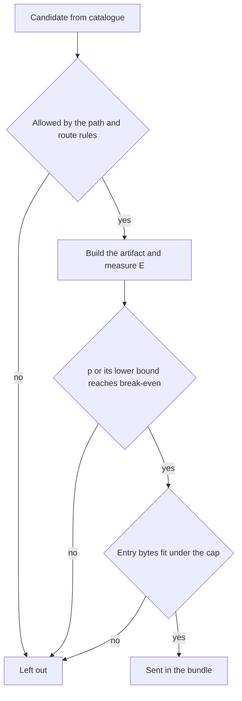

# Wire Protocol

This page describes what the server half and the worker send each other: paths, headers, JSON bodies and limits. It is written for someone who writes an adapter or a second server. The reference implementation is `src/protocol` (types, parsers and codecs both halves share), `src/server` (`createSpool`) and `src/sw` (the worker). Each value below carries the name the source gives it and the file that holds it. [security.md](security.md) covers the threat model and [impact.md](impact.md) covers the energy figures.

`tests/node/docs.spec.ts` reads this page and fails when a header, a path, a `MAX_*` constant or a protocol constant in `src/protocol/index.ts` differs from the tables here.

## Conventions

- Every JSON body carries `protocol`, an integer. `PROTOCOL_VERSION` is `1` (`src/protocol/artifact.ts`).
- Header names are case-insensitive. `HEADERS` holds them in lowercase and this page writes them in Title Case in prose.
- A header or query integer matches `^\d{1,15}$`: decimal digits only, 15 at most.
- Tags and artifact ids are opaque strings. An artifact id is the request path it answers, so it starts with `/`.
- A tag is a dependency name such as `node:1`. A tag's version is the vector cursor at its last change.
- Every JSON answer from the server half is `Content-Type: application/json` with `Cache-Control: no-store`. A principal artifact answers `private, no-store`.
- A refusal is `{"error": "<message>"}`. A `ProtocolError` (`src/protocol/errors.ts`) answers `400` with its message. Any other exception answers `500` with `{"error":"internal error"}` and no detail.

## Paths

`PATHS` (`src/protocol/config.ts`) names the six paths a server half owns.

| `PATHS` key | Path               | Methods   | Answered by                                         |
| ----------- | ------------------ | --------- | --------------------------------------------------- |
| `sync`      | `/.spool/sync`     | GET, HEAD | `respondSync`, `src/server/sync.ts`                 |
| `artifact`  | `/.spool/artifact` | GET, HEAD | `respondArtifact`, `src/server/spool.ts`            |
| `dataset`   | `/.spool/dataset`  | GET, HEAD | `respondDataset`, `src/server/dataset.ts`           |
| `beacon`    | `/.spool/beacon`   | POST      | `respondBeacon`, `src/server/beacon.ts`             |
| `write`     | `/.spool/write`    | PUT       | `createWriteServer`, `src/server/write.ts`          |
| `worker`    | `/spool-sw.js`     | GET       | `spool.stub()`; `handle` routes it, an adapter does |

Two more paths are not in `PATHS`.

| Path                            | Methods   | Answered by                                                                 |
| ------------------------------- | --------- | --------------------------------------------------------------------------- |
| `/.spool/<version>/client.js`   | GET, HEAD | `clientPath(VERSION)` in `src/protocol/config.ts`, answered in `answer()`   |
| `/.spool/<version>/navigate.js` | GET, HEAD | `navigatePath(VERSION)` in `src/protocol/config.ts`, answered in `answer()` |
| `/.spool/purge`                 | POST      | `PURGE_PATH` in `src/proxy/purge.ts`; proxy mode only                       |

`SPOOL_PREFIX` is `/.spool/`. Every path under it belongs to spool. `createSpool` refuses a `beacons` or `logout` entry under it. A request under the prefix that no row above claims answers `404` with `{"error":"not found"}`, and so does a method a row does not list. The exceptions are `/.spool/beacon` and, in proxy mode, `/.spool/purge`: both answer `405` with `Allow: POST`.

### Worker Script

`/spool-sw.js` answers `200` with `Content-Type: text/javascript; charset=utf-8`, `Cache-Control: max-age=86400` and `Service-Worker-Allowed: /` (`workerResponse`, `src/server/stub.ts`). The body is `self.__SPOOL_CONFIG__=<SwConfig as JSON>;`, a newline, then the worker core, or the site's own bundle when `createSpool` gets `worker`. With `cdn: { worker }` the body is the config line, a newline and one line, `importScripts("<core url>");`, in place of the core (`workerImport`, `src/server/stub.ts`); the core URL is `https://cdn.drupflare.com/spool/<version>/spool-sw.js?h=<hash>` unless `worker.url` names another, and `<hash>` is the `shellHash` of the core, so a changed core is a new URL. The headers, the `ETag` and the `304` are the same, over the shorter body. `SwConfig` is in `src/protocol/config.ts`. The page registers the script with `updateViaCache: 'all'`, and the day-long `max-age` is what lets Chromium and Firefox skip the update check for a controlled navigation. A deploy changes the bytes and reaches a browser within that day.

`spool.stub(request)` adds `ETag: "<hash>"`, the SHA-256 of the exact script bytes as base64url in quotes (`workerEtag`, `src/server/stub.ts`). A request whose `If-None-Match` names that tag, as a strong or `W/` tag, in a list or as `*`, gets `304` with no body and the same `Cache-Control`, `ETag`, `Service-Worker-Allowed` and `Content-Type`. Any other value gets the `200` and its bytes. `HEAD` gets the headers and no body, and a matching `HEAD` gets `304`. The tag changes with the config, the pack head, the policy and the `stamp`, because each changes the bytes, and it repeats for the same inputs. `handle`, `spoolExpress`, `spoolHono`, `spoolProxy` and the Vite and Nuxt handlers pass the request in. `spool.stub()` with no argument returns the response as before, with no validator, so a host that wires it that way gets the old cost. The `_headers` rule for the static file names no validator header, so it leaves the host's own `ETag` alone. Whether a given static host sends one is not verified here.

A browser that revalidates a stale script sends the tag back, so a re-check after the lease costs a `304` when the script is unchanged and one full response when it changed. WebKit's update check sends no `If-None-Match`, so it gets the full script each time with or without the tag (measured in Playwright WebKit 27.2). A site with one view a day pays the full response on each day the script changed since the last one.

### Page Runtime Script

`/.spool/<version>/client.js` answers `200` with the page runtime, `Content-Type: text/javascript; charset=utf-8` and `Cache-Control: public, max-age=31536000, immutable`. `<version>` is `VERSION` (`src/version.ts`) percent-encoded. A different version answers `404`. A server that serves the script from a CDN passes `cdn` to `createSpool`, and the tag then names that URL.

`/.spool/<version>/navigate.js` answers the same way. The page runtime loads it, as a classic script, once it holds a head: the first document's ring or a pack. A page with no head never requests it.

### Client Tag

`decorate` puts one tag in each HTML page (`clientTag`, `src/protocol/tag.ts`). By default, on a `second-view` site, the tag is an inline gate: `<script data-spool-gate data-src="<url>" data-held="<paths>">…</script>`. The gate counts the page view in `localStorage` and loads nothing. It waits for the first same-origin click or GET form submit whose URL matches `data-held` (a prefix such as `/courses/` for a URL with no query string, or `?` and a path for a list that answers one) and whose page has a ring that names a `boot` script. It then cancels that navigation and loads the boot script, `/.spool/<version>/boot/<pack>.js` (`bootPath`, `src/protocol/config.ts`), which holds the page runtime, the navigation script, the pack as base64 and the routes and templates the runtime needs. The ring names it as `<path>?r=<id>`, where `id` is 12 hex characters of the SHA-256 of those routes and templates, so a deploy that changes a template names a new URL under the same pack version. One request replaces the document the click would have fetched, so a visitor makes no more requests than the same site without spool. The runtime installs the pack and renders the clicked URL in the page, or loads it as a document when the held rows cannot answer. A client router (Nuxt's `NuxtLink`, for one) cancels the click on the anchor before the gate's document listener runs. The gate then leaves the click and the navigation to the router and loads the boot script beside it, so that click makes the router's own request plus the boot script, one more than the same site without spool. The gate also leaves `__SPOOL_BOOT__ = { router: true }`, and the runtime registers the worker on that view (`bootstrap({ router: true })`), because a router makes no document views and the third one would never come. The stub is one more request on that click, a static file request where the site serves it as a file. The worker controls the page from then on (it calls `clients.claim()`), so later reads the router makes go through it, and it answers the ones a declared `data` route covers. A site whose visitors navigate by document is unchanged: the worker registers on the third document view. The gate stores the boot path in `spool:boot`; later documents load it from the browser cache at once. A typed URL, a reload or a new tab is a document, and the gate leaves it alone until a click has loaded the boot script, with one exception: on the third document view inside one lease period it loads the boot script itself, so the worker registers for a visitor who never clicks. The count holds only the views a lease period still covers, because a visitor who returns once per lease would pay the install and save nothing. `spool:stamps` keeps the times of those views (at most three, in milliseconds); `spool:views` keeps the lifetime count, which the gate still writes and which a page with no `lease` uses. A stamp in the future, or a corrupt value, counts as outside. That costs the boot script and the stub once, and later documents are answered by the worker. The gate skips it on a page with `data-spool-worker="never"`, on a page a worker already controls, and in WebKit unless the page has `data-spool-worker="always"` ([WebKit Default](#webkit-default)). On a gate site every public HTML page carries the ring, a landing page and a list page included, because a visitor can start anywhere; the ring there holds no rows, routes or templates and is the same on each page (`buildRing` with `slim`, `src/server/ring.ts`). A page with no ring, or whose ring names no boot script, loads its runtime from the second view. A gate also carries `data-integrity` when `cdn` is set and `data-spool-worker="never"` or `"always"` when `createSpool({ workerMode })` is set to that value. A site with `cdn` set has no boot script, because the boot script holds the runtime. `window.spool` does not exist until the boot script or the runtime has loaded, so page code that uses it on a first view must check for it. `createSpool({ clientTag: 'script' })` keeps the plain script tag, `<script src="<url>" defer data-spool-client></script>`, for a page whose Content-Security-Policy forbids inline scripts. A `first-view` site always uses the plain tag. The plain tag carries `integrity="<hash>" crossorigin="anonymous"` when `cdn` is set. The attribute `data-spool-worker="never"` tells a page with no ring that it must not ask for a worker. `SwConfig.clientTag` holds the exact string. `injectClientTag` puts it before `</head>`, else before `</body>`, else at the end, and leaves a page that already contains `data-spool-client` or `data-spool-gate` alone. The strict `script-src 'self'` policy blocks the inline gate; allow it with `'sha256-<base64 of the gate source>'` (`GATE_CORE`, `src/server/embedded.ts`), and the boot script then loads under `'self'`. The hash changes whenever the gate's text changes, so a site that pinned an earlier build's hash must recompute it from `GATE_CORE` in the build it deploys (after `bun run build:sw`); until then the gate is blocked and the page is a document load. Without the hash the page works as it did before spool, and `clientTag: 'script'` is the alternative. The worker injects the same string into every page it renders, so a local render and a network render are equal after `normalise`. A second server must inject the identical string at the same place, or shadow mode reports a mismatch on every page.

`decorate` injects only into a `GET` answered `200` as `text/html` with no `Content-Encoding`. When it changes the body it deletes `Content-Length` and weakens a strong `ETag` to `W/<etag>`.

On a public route, `decorate` returns the response unchanged when the response sets a cookie, carries `Cache-Control` with `private` or `no-store`, or has a `Vary` member other than `Accept-Encoding` or `Cookie`. No envelope, client tag or ring is added, so the worker keeps nothing from it. A principal route is not checked this way. The proxy applies the same response check with its `publicCookies` allowlist, so it keeps a page whose cookies are all on the list; `decorate` on its own allows no cookie.

## Headers

`HEADERS` is in `src/protocol/envelope.ts`. `encodeEnvelope`, `writeEnvelope` and `decodeEnvelope` are its codec.

| `HEADERS` key          | Header                   | Sent by                                                                               | Value                                                                      |
| ---------------------- | ------------------------ | ------------------------------------------------------------------------------------- | -------------------------------------------------------------------------- |
| `protocol`             | `spool-protocol`         | server, on every spool response                                                       | integer, `1`                                                               |
| `artifact`             | `spool-artifact`         | server, on a response the worker may keep                                             | `id=<id>; scope=<scope>; deps=<tag>,<tag>; v=<cursor>`                     |
| `invalidate`           | `spool-invalidate`       | server                                                                                | `<tag>=<version>, <tag>=<version>`                                         |
| `clear`                | `spool-clear`            | server                                                                                | `*`, or partition ids separated by commas                                  |
| `vector`               | `spool-vector`           | server                                                                                | integer cursor                                                             |
| `partition`            | `spool-partition`        | server, and on `/.spool/sync` with an identity                                        | token matching `^[A-Za-z0-9_-]{1,128}$`                                    |
| `vectorSeen`           | `spool-vector-seen`      | worker on requests, server on responses                                               | integer cursor                                                             |
| `provision`            | `spool-provision`        | server, on a `204` from `/.spool/artifact` or a `409` from `/.spool/dataset`          | `declined`                                                                 |
| `provisionReason`      | `spool-provision-reason` | server, beside `provision`                                                            | `benefit`, `budget`, `v0.3` or `native` (the control that bound a dataset) |
| `delta`                | `spool-delta`            | server, on a declared write's 2xx answer                                              | the rows the write changed, as BundleDelta JSON, up to 16,384 bytes        |
| `WRITE_HEADERS.digest` | `spool-write-digest`     | server, on a declared write's 2xx answer when the delta is over `spool-delta`'s limit | the set digest of the state the write reached                              |
| `have`                 | `spool-have`             | worker, on a same-origin request it sends to the network                              | integer, the pack version the device holds                                 |

`Spool-Vector-Seen` and `Spool-Have` are the spool headers a request carries. On a request, `Spool-Vector-Seen` is the cursor the worker holds. `Spool-Have` is the pack version the worker holds. The worker sends it on each same-origin request it makes to the network (a write, a miss, a network document or a data read), never cross-origin. When the version is older than the server's and the delta from it fits 16,384 bytes, the server answers with `Spool-Delta`. The worker applies that delta to its pack and drops the artifacts whose tags it moved. A request without `Spool-Have` gets no delta, and a delta from an answer on another origin applies nothing. On a response it echoes that value, which says the `Spool-Invalidate` beside it is the complete diff since that cursor. The worker sends it on a same-origin `GET` that is not a navigation, when it holds a cursor and has no manifest (`passthrough`, `src/sw/runtime.ts`). The proxy deletes every `spool-` request header before it forwards a request.

`Spool-Provision` is set by `respondArtifact` directly and is not part of the `Envelope` type.

### Field Grammar

| Header             | Grammar                                                                                                                                                                                                                                                                                                                                        |
| ------------------ | ---------------------------------------------------------------------------------------------------------------------------------------------------------------------------------------------------------------------------------------------------------------------------------------------------------------------------------------------- |
| `spool-artifact`   | fields split on `;`, each `name=value` with a name at least one character long. `id` and `v` are required. `scope` is `public` or `principal`. `id` and each `deps` entry are percent-encoded. `h` is 43 base64url characters; `decodeEnvelope` drops any other value and keeps the rest. Unknown field names are ignored. `deps` is optional. |
| `spool-invalidate` | entries split on `,`. Each entry splits at its last `=`. The tag is percent-encoded and the version is an integer.                                                                                                                                                                                                                             |
| `spool-clear`      | tokens split on `,`, each percent-encoded. `*` is `CLEAR_ALL`.                                                                                                                                                                                                                                                                                 |

`h` is the only field added since v0.2. A v0.2 worker reads `id`, `scope`, `deps` and `v` by name and ignores `h`, so `Spool-Protocol` stays `1` (`tests/unit/envelope.spec.ts` parses the new header the v0.2 way).

`decodeEnvelope` treats an absent header as an absent field and throws `ProtocolError` with code `bad-header` on a malformed one. The worker reads a response through `decodeEnvelopeOrClear`. When `decodeEnvelope` throws, the worker ignores every spool header of that response except `Spool-Clear`, which it reads on its own. A valid `Spool-Clear` still applies, a malformed one counts as `*`, and a response whose `Spool-Protocol` names another version is ignored. `encodeEnvelope` refuses a `partition` that does not match the pattern.

Examples from `encodeEnvelope`, the first for the artifact of `/node/3` at cursor 1 with the tag `node:3`, the second for a response to `Spool-Vector-Seen: 1` when the cursor is 2 and only `b` changed (`tests/unit/server.spec.ts`):

```text
Spool-Protocol: 1
Spool-Artifact: id=%2Fnode%2F3; scope=public; deps=node%3A3; v=1
```

```text
Spool-Protocol: 1
Spool-Invalidate: b=2
Spool-Vector: 2
Spool-Vector-Seen: 1
Vary: Spool-Vector-Seen
```

### Other Headers

| Header                       | Set by                                                 | Meaning                                                        |
| ---------------------------- | ------------------------------------------------------ | -------------------------------------------------------------- |
| `X-Spool-Route`              | `decorate`, on a routed `GET` or `HEAD` answered `200` | the route pattern that matched                                 |
| `X-Spool-Mode`               | `decorate`, with `X-Spool-Route`                       | `serve` or `shadow`                                            |
| `Vary: Spool-Vector-Seen`    | `decorate`, on a read that sent `Spool-Vector-Seen`    | keeps a shared cache from replaying one diff to another cursor |
| `Clear-Site-Data: "storage"` | `decorate`, when called with `hardReset: true`         | the browser's own reset of everything the origin holds         |
| `Service-Worker-Allowed: /`  | `workerResponse`                                       | lets the worker control the whole origin                       |

### Security Headers

A page the worker renders from an artifact has no network response of its own, so the worker replays headers of the network responses it saw. `POLICY_HEADERS` (`src/sw/policy.ts`) is the list: `Content-Security-Policy`, `Content-Security-Policy-Report-Only`, `X-Frame-Options`, `X-Content-Type-Options`, `Referrer-Policy`, `Permissions-Policy`, `Cross-Origin-Opener-Policy`, `Cross-Origin-Embedder-Policy` and `Cross-Origin-Resource-Policy`. A server half sends nothing new for this: the application's own headers are the source.

- The worker stores the set from a `200` HTML navigation to a route's path with no query string and from a `200` `data` read, under that path. Any `200` same-origin HTML navigation also replaces the site-wide set.
- A local render replays the path's own set, or the site-wide set when the path has none. With neither, the worker leaves the view to the network.
- The worker script (the stub) carries the site-wide set as `policy` in its config: from `createSpool({ policy })`, or else the set of the last HTML page the server answered, limited to the names above. A set can be empty: a site that sends no security header names an empty list, and the worker takes that as the site's policy. With neither an option nor a page seen, the stub names no policy. The worker adopts the set at activation, only while it holds no site-wide set. A set a route stores later still wins. A page message, the ring and a navigation response cannot set the site-wide set. A changed policy changes the script text, so the worker updates like any other script change.
- `static` routes replay all the headers they stored instead. The sets are persisted with the replica and removed with it.

[security.md](security.md#content-security-policy) states the consequences.

## The Envelope

`Envelope` (`src/protocol/envelope.ts`) is every spool header of a response, decoded.

| Field        | Header              | Type                                  | Meaning                                                                                                                                                                              |
| ------------ | ------------------- | ------------------------------------- | ------------------------------------------------------------------------------------------------------------------------------------------------------------------------------------ |
| `protocol`   | `spool-protocol`    | integer                               | the protocol version the sender speaks                                                                                                                                               |
| `artifact`   | `spool-artifact`    | `{ id, scope, deps, version, hash? }` | this response is the artifact for `id` at cursor `version`, built from the tags in `deps`; `hash` is described under [The Body Carries the Artifact](#the-body-carries-the-artifact) |
| `invalidate` | `spool-invalidate`  | tag to version                        | tags that changed, each with the cursor at its last change                                                                                                                           |
| `clear`      | `spool-clear`       | list of strings                       | partition ids to wipe, or `*` for everything                                                                                                                                         |
| `vector`     | `spool-vector`      | integer                               | the server's cursor                                                                                                                                                                  |
| `seen`       | `spool-vector-seen` | integer                               | echo of the request's cursor; `invalidate` is the complete diff since it                                                                                                             |
| `partition`  | `spool-partition`   | string                                | the partition the response belongs to                                                                                                                                                |

### What decorate Sends

`decorate` (`src/server/spool.ts`) adds these by case. `MAX_PIGGYBACK` is `32` and is described under [Limits](#limits).

| Case                                                                                                   | Headers added                                                                                                                                                                   |
| ------------------------------------------------------------------------------------------------------ | ------------------------------------------------------------------------------------------------------------------------------------------------------------------------------- |
| any response except status `101`, which is returned untouched                                          | `Spool-Protocol: 1` and `Spool-Vector` with the cursor read before the application ran, unless a row below removes it                                                           |
| `GET` or `HEAD` with `Spool-Vector-Seen: n`, `n` at most the cursor, changes at most 32                | `Spool-Invalidate` with every changed tag (omitted when none changed), `Spool-Vector` with the cursor, `Spool-Vector-Seen: n`                                                   |
| the same, with more than 32 changed tags                                                               | `Spool-Protocol` only. The worker takes nothing from it and asks `/.spool/sync` later                                                                                           |
| the same, with `n` ahead of the cursor                                                                 | `Spool-Clear: *`, `Spool-Vector` with the cursor, `Spool-Vector-Seen: n`                                                                                                        |
| the same, with `n` not an integer                                                                      | `Spool-Protocol` only                                                                                                                                                           |
| any method but `GET` and `HEAD`                                                                        | `Spool-Vector` with the cursor after the write. The tags the write changed ride in `Spool-Invalidate`; more than 32 changed, or a vector that was reset, sends `Spool-Clear: *` |
| `clear` option                                                                                         | `Spool-Clear` with those tokens, replacing any value the rows above set                                                                                                         |
| identity resolves and the response has no `Spool-Partition`                                            | `Spool-Partition` for that principal                                                                                                                                            |
| routed `GET` or `HEAD` answered `200`, HTML or a `static` or `data` route, public or identity resolves | `Spool-Artifact` with `version` set to the cursor read before the application ran                                                                                               |

The cursor is read before the application runs, so a write that races a render leaves the artifact looking older than the write, which makes the worker refetch it. `handle` reads the cursor first and passes it to `decorate`.

A page the proxy declines can still tell the worker to drop its copy: the proxy writes `Spool-Invalidate` with the tag `spool:artifact:<path>` at a version one past the cursor. The version is not recorded in the vector.

### How the Worker Reads an Envelope

The worker (`early` and `observe` in `src/sw/runtime.ts`, `applyEnvelope` in `src/sw/replica.ts`) applies a response's spool headers only when `Spool-Protocol` equals `PROTOCOL_VERSION`. Any other value, or none, makes the response an ordinary one.

- `Spool-Clear` with `*` empties the replica and sets the cursor to `Spool-Vector` when present.
- `Spool-Invalidate` raises tag versions. It always applies.
- The cursor and the sync clock advance only when the response carries `Spool-Vector-Seen` equal to the value the worker sent, carries `Spool-Vector`, and has no `Age` header. A copy a shared cache replays cannot extend freshness.
- `Spool-Artifact` on a navigation (or on a `data` route read) makes the worker fetch `/.spool/artifact?path=<id>` when it holds no artifact for `id`, the route matches and is provisionable (a family route with no `load` is not, and the server advertises no artifact for it), the strategy is not `static`, the scope matches, the held pack does not already render the route (a public family route whose row the pack holds needs no artifact), and the worker has not been told to leave that path to the network: a `204` declined it, or a `404` answered it at the same version. A `404` is asked again only when the version moves. For a `static` route the worker keeps the response itself, bytes and headers, when the advertised id equals the path and the scope is `public`.
- A navigation response that names a hash in `Spool-Artifact` may hold the artifact itself, and the worker then stores it without the request above. See [The Body Carries the Artifact](#the-body-carries-the-artifact).
- A principal artifact is fetched only when the response's `Spool-Partition` equals the partition the worker holds.
- A `/.spool/sync` answer is read the same way before the worker uses it (`fetchSync`, `src/sw/runtime.ts`). A `Spool-Partition` that differs from the held partition swaps the store, and an answer with none wipes the principal store as a session that ended. A sync answer therefore ends a sign-in or sign-out the worker never saw.
- A response's security headers are not part of the envelope, and the worker keeps them as well. See [Security Headers](#security-headers).

## Version Vector

The version vector is the server's record of change (`VersionVector`, `src/protocol/vector.ts`). A store behind it implements `VersionStore` (`src/stores/version-store.ts`): `bump(tags)`, `cursor()` and `diff(from)`.

- The cursor starts at `0` and only moves forward. `bump` moves it by exactly one, whatever the number of tags, and stamps each tag with the new value. `bump([])` changes nothing.
- A tag's version is the cursor at its last change, and `0` when it never changed.
- `diff(from)` is every tag whose version is above `from`, with the current cursor. When `from` is above the cursor, the holder has lost its server (a restart that forgot state, a different deployment), and the diff has `reset: true` and every tag. The holder wipes what it holds.
- A store must keep the cursor monotonic across restarts. `memoryStore` begins at `0` on every start unless it is given a snapshot, so after a restart every worker holding a higher cursor is told to reset. `SpoolVersions` (`src/stores/durable-object.ts`) keeps one SQLite row per tag and one cursor row.
- An artifact's `vector` is the cursor read before the artifact was built. The worker keeps an artifact while no tag in its `deps` has a version above that `vector` (`isCurrent`, `src/sw/freshness.ts`).
- The worker's copy only moves forward. A tag version is raised only by a higher value, the cursor takes the maximum, and a copy built before a change it already knows of is refused at `put`.
- An artifact can be dropped by id. `spool.invalidate(tags, { drop })` bumps the tag `spool:artifact:<id>` (`ARTIFACT_TAG_PREFIX`, `artifactTag`, `src/protocol/sync.ts`). The sync answer lists such ids in `dropped` and does not list the tag in `changed`.

`VersionVector.from(snapshot)` accepts a cursor that is a non-negative safe integer and tag versions from `1` to the cursor.

Example, from `tests/unit/wire.spec.ts`. After `bump(['node:1', artifactTag('/page')])`, `toSyncResponse(diff(0))` is:

```json
{
  "protocol": 1,
  "cursor": 1,
  "changed": { "node:1": 1 },
  "dropped": ["/page"],
  "reset": false
}
```

## Sync

`GET /.spool/sync` answers what changed. Two forms exist, `from` and `need`. `need` wins when both are present.

### Sync by Cursor

`?from=<n>` takes the worker's cursor. Any other value, or none, answers `400` with `from must be a non-negative integer`. The answer is a `SyncResponse` (`src/protocol/sync.ts`):

| Field      | Type            | Meaning                                                                     |
| ---------- | --------------- | --------------------------------------------------------------------------- |
| `protocol` | `1`             |                                                                             |
| `cursor`   | integer         | the server's cursor; the holder takes it                                    |
| `changed`  | tag to integer  | every tag whose version is above `from`, without the `spool:artifact:` tags |
| `dropped`  | list of strings | artifact ids the server dropped after `from`                                |
| `reset`    | boolean         | `from` is ahead of the cursor: wipe everything held, then take `cursor`     |
| `partial`  | boolean         | present and `true` only in a `need` answer                                  |

The headers are `Spool-Protocol: 1` and `Spool-Vector: <cursor>`. When `createSpool` has an `identity` option, the answer also carries `Spool-Partition` for the identity the request's cookies resolve to, and carries none when they resolve to nobody. The worker applies it as it does on a navigation, and a server without an `identity` option sends none. Example, from `tests/unit/server.spec.ts`, after `invalidate(['node:1', 'menu'])` and `invalidate(['node:2'], { drop: ['/page/x'] })`, for `GET /.spool/sync?from=1`:

```json
{
  "protocol": 1,
  "cursor": 2,
  "changed": { "node:2": 2 },
  "dropped": ["/page/x"],
  "reset": false
}
```

### Sync by Need

`?need=<held>` asks only about the ids the next page reads. `<held>` is `id@version` pairs joined by commas, with each id percent-encoded (`encodeHeld`, `parseHeld`, `src/protocol/sync.ts`). The worker sends every tag an artifact depends on, and the artifact's own `spool:artifact:<id>` tag, each at the artifact's `vector`. Parsing splits on `,`, ignores empty parts, takes the version after the last `@` and requires it to be an integer. More than `MAX_NEED` entries, or a malformed one, answers `400`. A worker whose artifact depends on more than `MAX_NEED` tags falls back to a full sync. The `need` of a principal page also names the tags of the catalogue entries held and unopened (see [Principal Entries](#principal-entries)), and the same fallback applies to the union.

The answer has `partial: true`. `changed` holds only the asked-about tags whose version is above the version asked with. `dropped` holds the artifact ids whose drop tag passed it. The `cursor` in a partial answer is not the holder's to take, because the answer covers only part of the diff, and `applySync` leaves the cursor and the sync clock alone. `reset` is `true` when the highest version asked about is above the server's cursor, and `changed` is then empty. An empty `need=` answers the cursor alone, with `partial: true`.

Example, from `tests/unit/server.spec.ts`. After `invalidate(['a', 'b'])`, `invalidate(['c'], { drop: ['/page/x'] })` and `invalidate(['a'])`, the request carries this `need` before it is percent-encoded as a query value:

```text
a@1,b@1,c@3,d@0,spool%3Aartifact%3A%2Fpage%2Fx@1
```

The answer is `Spool-Vector: 3` and:

```json
{
  "protocol": 1,
  "cursor": 3,
  "changed": { "a": 3 },
  "dropped": ["/page/x"],
  "reset": false,
  "partial": true
}
```

`b` and `d` are absent because neither moved past the version asked, and `c` is absent because it was asked at `3`.

## Artifact

`GET /.spool/artifact?path=<path>[&have=<held>]` answers the artifact for a path. The request carries the visitor's cookies, so `identity.resolve` sees the visitor.

| Parameter | Meaning                                                                                                                                                         |
| --------- | --------------------------------------------------------------------------------------------------------------------------------------------------------------- |
| `path`    | a pathname that starts with `/`. Anything else answers `400` with `path must start with "/"`. The server matches it as given, so send no query string.          |
| `have`    | `id@version` pairs, in the format of `need`, for the records and projections the worker holds. More than `MAX_HAVE` entries, or a malformed one, answers `400`. |

The server picks the first route whose pattern matches. It reads the cursor, runs `depends` and `load`, collects the records and projections the load registered, validates the result with `parseArtifact`, and drops from `records` and `projections` whatever `have` already covers at a version no change has passed. When the holder claims a version from the future the server sends everything.

| Status | Body or headers                                                         | When                                                                                                                                |
| ------ | ----------------------------------------------------------------------- | ----------------------------------------------------------------------------------------------------------------------------------- |
| `200`  | an `Artifact`; `Spool-Protocol: 1`                                      | the route is public, or principal and the identity resolves                                                                         |
| `200`  | as above, plus `Spool-Partition` and `Cache-Control: private, no-store` | a principal route                                                                                                                   |
| `204`  | `Spool-Provision: declined`, `Cache-Control: no-store`                  | the public artifact costs more than its expected reuse repays; see [Provisioning](#provisioning)                                    |
| `400`  | `{"error": <message>}`                                                  | bad `path` or `have`; a `$record` or `$projection` reference the load did not register; a built artifact that fails `parseArtifact` |
| `401`  | `{"error":"sign in"}`                                                   | a principal route and no identity                                                                                                   |
| `404`  | `{"error":"no route"}`                                                  | no pattern matches                                                                                                                  |
| `404`  | `{"error":"a static route is not provisioned"}`                         | the route's strategy is `static`                                                                                                    |
| `500`  | `{"error":"internal error"}`                                            | `load` threw something other than a `ProtocolError`                                                                                 |

### The Artifact Body

`Artifact` (`src/protocol/artifact.ts`) is `protocol`, `id`, `scope`, `deps`, `vector`, optional `records` and `projections`, `strategy` and `body`. `parseArtifact` is what the worker calls before it stores anything.

| Field         | Rule                                                                                                                                                   |
| ------------- | ------------------------------------------------------------------------------------------------------------------------------------------------------ |
| `protocol`    | must equal `PROTOCOL_VERSION`                                                                                                                          |
| `id`          | a string that starts with `/`                                                                                                                          |
| `scope`       | `public` or `principal`                                                                                                                                |
| `deps`        | a list of strings: the route's `depends` result, plus every record id and every projection dependency                                                  |
| `vector`      | a non-negative safe integer: the cursor read before the artifact was built                                                                             |
| `strategy`    | `template`, `projection`, `data` or `assembly`                                                                                                         |
| `body`        | for `template`, `projection` and `data`, `{ "data": <any JSON> }`. For `assembly`, `{ "shell": <string>, "fragments"?: <object>, "slots"?: <object> }` |
| `records`     | optional list of `{ id, version, data }`, each `id` a non-empty string and `version` a non-negative integer                                            |
| `projections` | optional list of `{ id, version, deps, data }`, each `deps` a list of strings                                                                          |

`parseArtifact` refuses a `static` artifact and any other strategy with `bad-artifact`. A static artifact exists only inside the worker, which builds it from a response it fetched, and `/.spool/artifact` answers `404` for a static route.

A page's data refers to a record with `{"$record": "<id>"}` and to a projection with `{"$projection": "<id>"}`. A reference is an object with that one key. The worker replaces each reference with the stored value when it renders, and refuses to render a page whose reference has nothing behind it. A projection that reaches itself is refused. An assembly `fragments` or `slots` value is either a string or a reference.

An assembly shell holds a hole as `<span data-spool-placeholder="<id>"></span>` (`placeholder`) and a named value as `{{spool-slot:<name>}}` (`slot`, names match `[A-Za-z0-9_.-]+`), both in `src/protocol/assembly.ts`. The worker refuses to render a shell with an unfilled hole or slot.

Example for a template route, built from the format `parseArtifact` accepts (the key order is the server's):

```json
{
  "protocol": 1,
  "id": "/c/101",
  "scope": "public",
  "deps": ["course:101"],
  "vector": 0,
  "records": [{ "id": "course:101", "version": 0, "data": "Intro" }],
  "strategy": "template",
  "body": { "data": { "title": { "$record": "course:101" } } }
}
```

The artifact answer for `/node/7` in `tests/unit/server.spec.ts` is the same shape without `records`: `deps` is `["node:7"]` and `body` is `{ "data": { "id": "7" } }`.

### The Body Carries the Artifact

A navigation to a public route the worker holds nothing for costs a second request, `/.spool/artifact`. When the page body already contains the artifact, the server says so with `h` in `Spool-Artifact`, the base64url SHA-256 (no padding) of the UTF-8 text the body carries, and the worker stores the artifact from the response it already has (`derive`, `src/sw/runtime.ts`). Two routes use it.

| Route             | What `h` hashes                                                                                                                    | What the worker stores                                                                                                 |
| ----------------- | ---------------------------------------------------------------------------------------------------------------------------------- | ---------------------------------------------------------------------------------------------------------------------- |
| public `assembly` | the shell as the proxy builds it, before the client tag goes in (`DecorateOptions.assembled`)                                      | `{ id, scope: "public", strategy: "assembly", deps, vector: v, body: { shell } }`, with `deps` and `v` from the header |
| public `template` | the text of the inline element, see below, which is the artifact JSON with `<`, `>`, `&` and U+2028 and U+2029 written as `\uXXXX` | the artifact parsed from that text, which `parseArtifact` validates                                                    |

The worker reads a clone of the response after it has handed the response to the page, so the page never waits for it. It decodes the body as UTF-8 and refuses invalid bytes. For an `assembly` route it removes the first copy of its configured client tag, hashes what is left, and compares. For a `template` route it takes the last inline element, hashes its text and compares. Any mismatch, a missing `h`, a body over `MAX_STATIC_BYTES`, an unreadable body (compressed bytes with no decoding, another charset), a route in shadow mode, a route the server declined, a principal route, a status other than `200`, or a redirect leaves nothing stored, and the worker asks `/.spool/artifact` as before. A stored artifact is charged to the ledger with `requests: 0`: its `bytes` are `0` for an assembly page, which moved no extra bytes, and the element's size for a template page.

The proxy passes `assembled` only for a public `assembly` page whose body it holds exactly as `/.spool/artifact` would build it. A page rewritten for a visitor signal (`video` with `when: 'save-data'` or `'slow'`) is declined as `private`, so it has no `Spool-Artifact` at all. The proxy's stored copy and the page the visitor got are then the same text, which also removes the second origin fetch of every cold view.

**Inline element.** With `inlineMaxBytes` above `0` on `createSpool`, `decorate` appends this element before the last `</body>` of a public `template` page, or at the end when the page has none, and names the hash of its text in `Spool-Artifact`.

```html
<script
  type="application/spool+json"
  data-spool-artifact
>
  {"protocol":1,"id":"/n/1",...}
</script>
```

- The text is the artifact JSON from the same code `/.spool/artifact` runs (`buildArtifact`), built for a request with no cookies and `Accept: application/json`, so it is public data. It is left out when the route would be declined, when the build fails, or when the escaped text is over `inlineMaxBytes` bytes.
- `<`, `>`, `&`, U+2028 and U+2029 are written as `\uXXXX`, so the text cannot contain `</script` and `JSON.parse` returns the original.
- Only a `GET` answered `200` as HTML without `Content-Encoding` is changed, and its `ETag` becomes weak. A principal route and an `assembly` route never get the element.
- The worker takes the last element and requires its hash to equal `h`, its `id` to equal the path, its scope to be `public` and its strategy to be the route's `template`.
- `normalise` removes the element, so shadow comparison and `equivalent` ignore it.
- The default is `0`. Every network view of the page pays the element's bytes and one more `load`, whether or not the visitor runs a worker, and a view the worker could have skipped has no way to ask. The first-payload reading (`measurements/first-payload/`) has the numbers.

## Beacon

`POST /.spool/beacon` takes the events the worker held, in one body, and answers with artifacts when the worker asked for some.

### The Batch

`BeaconBatch` (`src/protocol/beacon.ts`) is `{ protocol, events, want? }`. `parseBeaconBatch` validates it.

| Field       | Rule                                                                                                                                                              |
| ----------- | ----------------------------------------------------------------------------------------------------------------------------------------------------------------- |
| `events`    | a list of at most `MAX_BEACON_EVENTS` events                                                                                                                      |
| `want`      | optional list of at most `MAX_WANT` strings, each starting with `/`; artifact paths to answer                                                                     |
| `catalogue` | optional `{ path, sweep? }`: `path` starts with `/` and has at most `MAX_CATALOGUE_PATH` characters, and `sweep` is `true` or absent; see [Catalogue](#catalogue) |

`BeaconEvent` fields:

| Field         | Rule                                                                                       |
| ------------- | ------------------------------------------------------------------------------------------ |
| `path`        | a string that starts with `/`                                                              |
| `body`        | a string                                                                                   |
| `contentType` | a string                                                                                   |
| `at`          | a finite number: epoch milliseconds on the device                                          |
| `search`      | optional string: the original query string with its `?`                                    |
| `method`      | optional, only `GET`; absent means `POST`                                                  |
| `origin`      | optional string: the origin of a held cross-origin request                                 |
| `vendor`      | optional string: the collector entry that matched                                          |
| `deliver`     | optional, only `sink`: the worker did not replay the event, so the server half forwards it |

The worker also keeps an `until` field on a held event, the time after which it drops the event. It removes `until` before it sends a batch, and `parseBeaconBatch` does not read it.

Example, from `tests/unit/server.spec.ts`. The server hands the events to the `sink` and answers `204` with `Cache-Control: no-store`:

```json
{
  "protocol": 1,
  "events": [
    { "path": "/cdn-cgi/rum", "body": "{\"a\":1}", "contentType": "application/json", "at": 5 }
  ]
}
```

### What Travels in a Batch

`OWN_PREFIX` is `/.spool/`. An event whose path is under it, and an event with `deliver: "sink"`, travel in the batch. The worker replays every other held request to the URL the page meant, with its method, content type, query and body, and does not put it in a batch. Three paths under the prefix are events and not endpoints:

| Constant       | Path              | Body                                                                                       |
| -------------- | ----------------- | ------------------------------------------------------------------------------------------ |
| `VIEW_PATH`    | `/.spool/view`    | a `ViewEvent`, JSON; see [View Events](#view-events)                                       |
| `LOADS_PATH`   | `/.spool/loads`   | `{ view, count, origins? }`, JSON; the page's report of cross-origin loads for view `view` |
| `DROPPED_PATH` | `/.spool/dropped` | `{ vendor, count }`, JSON; events the worker dropped past a vendor's age cap               |

A loads report is valid when `view` is a non-empty string of at most 64 characters, `count` is a non-negative safe integer, `origins` has at most `MAX_LOAD_ORIGINS` entries, each name is at most 253 characters and each count is a safe integer of at least `1` (`loadsFromBeacon`, `src/protocol/view.ts`). The last report for a view wins.

### The Answer

The server refuses a request body longer than `MAX_BEACON_BODY` characters with `413`, a body that is not JSON or a batch that does not validate with `400`, and any method but `POST` with `405` and `Allow: POST`. It writes the batch's events to the `sink`. A batch with `want` answers `200` with `{"protocol":1,"artifacts":[<Artifact>,...]}`: the public artifacts the server can build for those paths, in the order asked. A path that is principal, static, unrouted, declined by the provisioning rule or fails to build is left out. A batch with `catalogue` adds a `catalogue` list of artifacts to the answer when the server chose any; see [Catalogue](#catalogue). A batch with neither, or one whose catalogue came out empty and that asked for nothing else, answers `204`.

`MAX_BEACON_BYTES` bounds one event's body on the worker. A request body over it, or one whose content type is `octet-stream`, `multipart` or an `image/` type, goes to the network at once and is not held. `MAX_BEACON_BODY` bounds the whole request on the server. The first counts UTF-8 bytes and the second counts characters.

### When a Flush Happens

The worker flushes on a request that happens anyway (a "network moment") when a site's own beacon is held, artifacts are wanted, a catalogue ask is due, the oldest held event is an hour old, or 20 views are held. Held events alone leave on their own at most once every 24 hours, when the oldest is a day old. One request carries at most `FLUSH_CHUNK` events, and `want` and `catalogue` ride the first chunk only. A due ask counts only at a network moment with something held to carry it: a local view never flushes, and a moment with nothing held makes no request. The ask is due again `CATALOGUE_REASK_MS` after it was answered, so one page's catalogue costs one `POST /.spool/beacon` a day on a device. The constants are under [Limits](#limits). The server must accept a flush at any time and tolerate a batch of zero events.

### View Events

A view event is the JSON body of a `/.spool/view` event (`ViewEvent`, `src/protocol/view.ts`). `viewFromBeacon` accepts it only when every field validates. A stub with `views: false` makes the worker queue no view event, which is what a spool with no `sink` gets; an absent `views` means true.

| Field              | Type or values                                                  |
| ------------------ | --------------------------------------------------------------- |
| `id`               | string of 1 to 64 characters                                    |
| `tier`             | `local`, `local-revalidate`, `network`, `fallback` or `shadow`  |
| `reason`           | one of the reasons below                                        |
| `staleSec`         | number, or `null` when nothing was stored                       |
| `engine`           | `chromium`, `firefox`, `webkit` or `other`                      |
| `scope`            | `public` or `principal`                                         |
| `strategy`         | `assembly`, `template`, `static`, `projection` or `data`        |
| `route`            | the matched route pattern, at most `MAX_ROUTE_CHARS` characters |
| `mismatch`         | boolean, or `null` when no local render was made                |
| `swAgeMs`          | finite number: milliseconds since this worker instance started  |
| `gapMs`            | number, or `null` for the worker's first view                   |
| `from`             | optional: the referring route pattern, or `external`            |
| `crossOriginLoads` | non-negative integer, or `null` until the page reports          |
| `lifetimes`        | optional: non-negative integer, absent until the page reports   |

A view carries the route pattern and never the path, so a pattern such as `/node/:id` leaves the parameter out.

`from` follows the same rule. The worker sets it from the navigation request's referrer: the pattern of the declared route that a same-origin referrer matches, or `external` (`FROM_EXTERNAL`) for another origin. It is omitted when there is no referrer, the referrer is not an http(s) URL, or a same-origin referrer matches no route. A raw URL, a query string or an unmatched path is never written. `viewFromBeacon` drops a `from` that is not a string of 1 to `MAX_ROUTE_CHARS` characters and still accepts the view. Shadow views carry it too. `transitions` and `nextShare` (`src/report/traffic.ts`) count route-to-route moves from the views, so a server can estimate the chance of a visitor viewing a route next with no extra request. `REASON_TIER` maps each reason to the tier a serving worker gives it. A shadow view keeps the reason and takes the tier `shadow`.

| Reason             | Tier               | Meaning                                                               |
| ------------------ | ------------------ | --------------------------------------------------------------------- |
| `cold`             | `network`          | nothing stored                                                        |
| `principal`        | `network`          | a principal route the worker cannot serve (it has no partition store) |
| `fresh`            | `local`            | within the bound                                                      |
| `catalogue`        | `local`            | first open of a catalogue entry, shown with no request                |
| `soft-deferred`    | `local`            | past a soft bound, with the sync left for a network moment or a lease |
| `soft-sync`        | `local-revalidate` | past a soft bound, the sync queued for a network moment or a lease    |
| `hard-sync`        | `local-revalidate` | past a hard bound, synced first                                       |
| `offline-stale`    | `local-revalidate` | past a hard bound with the network down, shown anyway                 |
| `invalidated`      | `fallback`         | a change outdated the stored copy                                     |
| `stale-after-sync` | `fallback`         | the sync made the stored copy stale                                   |
| `hard-refused`     | `fallback`         | a hard route offline with `offline: 'refuse'`                         |
| `refused`          | `fallback`         | the worker declined to render the stored copy                         |

## Partitions and Clearing

A route with `scope: 'principal'` is stored per partition. The server tells the worker which partition a response belongs to with `Spool-Partition`, and the worker keeps each partition in its own store.

- `Spool-Partition` is an opaque token matching `^[A-Za-z0-9_-]{1,128}$`. `partitionId` (`src/server/identity.ts`) is the reference derivation: HMAC-SHA-256 under the server secret over `spool-partition:1`, a NUL byte and the principal, base64url without padding, which is 43 characters. The worker never recomputes it and compares tokens for equality.
- A response whose `Spool-Partition` differs from the one the worker holds replaces the store. The old partition is destroyed first, and the held same-origin requests are dropped before the swap, counted under `same-origin`.
- A navigation whose response carries spool headers and no `Spool-Partition` ends the session when the worker holds a principal partition: it wipes the principal store (`session-ended`). A response with no spool headers at all changes nothing.
- `Spool-Clear: *` wipes the principal store and the public replica. `Spool-Clear: <partition id>` wipes that partition when it is the one held, and leaves the public replica alone.
- `SwConfig.logout` lists patterns (the [route pattern language](#route-patterns)). A same-origin request whose path matches one, with any method, wipes the principal store when it reaches the worker, before the request is sent and after the worker has sent the held same-origin beacons or dropped them. The answer to that request cannot bring a partition back, even though it still names one.
- Each wipe broadcasts `{ "type": "spool:cleared", "reason": "<reason>" }` to every page of the origin. Reasons are `clear`, `partition`, `logout` and `session-ended`. The page runtime turns it into a `spool:cleared` event on `window`.
- `Clear-Site-Data: "storage"` is a browser feature and not part of the worker's logic. The server sends it when `decorate` is called with `hardReset: true`.

An application that logs a visitor in or switches accounts sets `Spool-Partition` on its own response with `spool.partition(principal)`. The request that response answers still carries the previous identity, so `decorate` alone would name the previous partition. [security.md](security.md) covers the window this leaves open when the application does not.

## Provisioning

The server decides whether a public artifact is worth sending, and answers `204` with `Spool-Provision: declined` when it is not. The worker then leaves that path to the network until it restarts. The rule is `benefit` in `src/protocol/provision.ts`, where `reuse` is the chance a provisioned artifact serves a later view, `futureViews` the later views one artifact serves, `avoided` the cost each such view keeps off the wire, and `provision` and `maintain` the costs of fetching the artifact once and keeping it current:

```math
\mathrm{reuse} \times \mathrm{futureViews} \times \mathrm{avoided} - \mathrm{provision} - \mathrm{maintain}
```

Each term is in bytes, with a request counted as `requestBytes`. An artifact is sent when the result is positive. A `data` route weighs against its own size. Principal artifacts are not weighed. A route's `provision.maxBytes` refuses an artifact whose stored JSON is over that many bytes, for every scope, before the benefit is weighed.

`DEFAULT_PRIOR` (`src/protocol/provision.ts`) holds the scenario priors the worker and the server use until telemetry replaces them. Every one is an assumption. `ProvisionConfig` in `src/protocol/config.ts` overrides them, and a route's `provision` field overrides `reuse` and `futureViews` for that route.

| Field           | Default | Meaning                                                           |
| --------------- | ------- | ----------------------------------------------------------------- |
| `reuse`         | `0.5`   | the chance a provisioned artifact serves a later view             |
| `futureViews`   | `2`     | later views one provisioned artifact serves                       |
| `requestBytes`  | `2000`  | what one request weighs in bytes                                  |
| `artifactBytes` | `20000` | size of one artifact before the worker has fetched any            |
| `avoidedBytes`  | `17054` | bytes one local view keeps off the wire                           |
| `changesPerDay` | `1`     | how often one dependency tag changes, per day, before any is seen |

A flush that carries `want` also provisions: the worker asks for visited shadow-mode routes and for the `hot` list, best benefit first, at most `MAX_WANT` paths.

## Catalogue

A catalogue sends the data of pages a visitor may open next, so that opening one makes no request. An entry is the artifact `/.spool/artifact` would build for a `template`, `projection` or `data` route, never HTML: the device already holds the template or the renderer. A whole page costs about as much to send as it saves, and a diff of markup needs most of a page's bytes as well, so neither is an entry.

An entry repays its transfer when the share of devices that open it, `p`, reaches `entryBreakEven` (`src/protocol/provision.ts`), where `E` is the entry's compressed bytes, `D` the bytes of the document it replaces, `k` is `JOULES_PER_BYTE` and `o` is `ORIGIN_JOULES`:

```math
p \geq \frac{k \times E}{k \times D + o}
```

Both come from the energy model ([impact.md](impact.md)): `k` is SWD v4's 0.194 kWh/GB over decimal gigabytes (L2), and `o` is the modelled origin request (L1). `chooseEntries` keeps the candidates at or above their own break-even, best expected net joules first, while their entry bytes fit under the cap. The expected net of a candidate is the value below, where `p` is the share of devices that open it:

```math
p \times (k \times D + o) - k \times E
```

A candidate that does not fit is skipped and a smaller one may still go.

A share that was estimated from counts is uncertain, so a candidate may carry `n`, the observations behind its `p`, and `createSpool` takes `catalogueConfidence`, `z`, a number of standard deviations (1.28 is one-sided 90%). Where `z` is above 0 and a candidate has an `n`, the rule above and the order use the lower Wilson bound of the share instead of `p`. Here `\hat p` is the candidate's `p`, `n` its observations and `z` the option:

```math
p_{\mathrm{low}} = \frac{\hat p + \frac{z^2}{2n} - z\sqrt{\frac{\hat p(1-\hat p)}{n} + \frac{z^2}{4n^2}}}{1 + \frac{z^2}{n}}
```

A candidate with no `n`, and every candidate when `z` is 0 (the default), keeps its `p`. `lowerBound` in `src/protocol/navigation.ts` computes it, and `NavModel` there keeps first-order counts with decay and a prior, returning a `p` and the weight to pass as `n`.

| Part                     | Where it is set                                                                                                                                   |
| ------------------------ | ------------------------------------------------------------------------------------------------------------------------------------------------- |
| candidates and their `p` | the route's `catalogue(ctx)`, for the page the visitor is on: `{ path, p }` pairs from the site's own `nextShare`, link position or a fixed prior |
| `D`                      | the entry route's `documentBytes`; the `avoidedBytes` prior when it has none; a `data` route's own entry size when it has none                    |
| `E`                      | the entry as JSON, measured by `catalogueSize` (Brotli through `CompressionStream`, gzip where the runtime has no Brotli stream)                  |
| the cap                  | `catalogueBytes`, the most compressed bytes of entries in one bundle; `DEFAULT_CATALOGUE_BYTES` when absent                                       |
| the most pages built     | `MAX_CATALOGUE_BUILD` candidates, best `p` first, whatever the route returns                                                                      |

A candidate is skipped when its path has a query string or a fragment, sits under `/.spool/`, is the page asked about, matches no route, matches a `static` or `assembly` route, or has a `p` outside 0 to 1. A route whose `catalogue` throws, or whose entries fail to build, sends nothing and the flush still answers as it would without it.

Each candidate goes through the same checks in this order, and any "no" leaves it out of the bundle:



### Asking and Delivery

The worker asks through the beacon batch it already sends. `BeaconBatch.catalogue` is `{ path, sweep: true }` for the last page whose route declares a catalogue (`SerializedRoute.catalogue`), at most once every `CATALOGUE_REASK_MS` for each path. The worker stores when it last asked for each of its `MAX_CATALOGUE_ASKED` latest paths beside its flush clocks, so a worker restart does not ask again. It rides the first chunk of a flush, and a due ask makes the next network moment flush when a spool event is held (see [When a Flush Happens](#when-a-flush-happens)). A flush that holds only a site's own beacons and wants no artifact sends no batch, so the ask waits for a view. The server answers with the entries in `catalogue`, an array of artifacts, in the order chosen. The worker stores each one like a provisioned artifact, with its records and projections stored once in the graph, and marks it unopened. An entry for a route whose strategy or scope differs from the entry's is dropped, and so is one the device already holds.

A request with `Save-Data: on` is sent no catalogue, but is still answered for `want`. The check reads the header of the beacon request, which the browser sets.

### Principal Entries

A principal route may be an entry only when the batch says `sweep: true`. The server builds it with the identity of the beacon request and sets `Spool-Partition` on the answer, with `Cache-Control: private, no-store`. The worker keeps a principal entry only when that header equals the partition it holds. A request that resolves to nobody gets no principal entry, and a principal page's catalogue is not built for it.

The sweep is the worker's half of revocation. Every sync of a principal page, not only the first, also names the dependency tags and the drop tag of every entry held in that partition that no page has opened (`Replica.sweep`), each at the vector its entry was built at, so a tag that moved drops the entry at the first required sync. When the union of those ids and the page's own is over `MAX_NEED`, the worker makes a full sync by cursor instead.

### Reason and Ledger

The first open of an entry that the worker shows with no request is a view with the reason `catalogue` and the tier `local`. Opening the entry clears its mark, so later views of the page are ordinary. An entry older than its route's bound, which the worker syncs before or after it shows, keeps the reason of that sync and is still opened. The worker's ledger charges each entry's JSON bytes to `catalogueBytes` and counts the first open in `catalogueViews`. `catalogueFigures` (`src/report/traffic.ts`) reads the views and the ledger: entries sent, entries used, hit share, and bytes sent against bytes saved. The saving it prints is a scenario figure until shadow views measure `p`.

## Protocol Version Skew

Both halves speak `PROTOCOL_VERSION`, now `1`. The rule has four parts.

- The worker ignores the spool headers of a response whose `Spool-Protocol` differs from its own, and of a response that has none. The response is then an ordinary one.
- `parseArtifact`, `parseSyncResponse` and `parseBeaconBatch` refuse a body whose `protocol` differs. The server answers a refused batch with `400`. The worker counts a refused sync or artifact as a failed request, which a hard route with `offline: 'refuse'` answers by going to the network.
- A page's `spool:hello` message carries its protocol, and the worker answers `{ type, protocol, version, compatible }` with `compatible` false when they differ. `register` returns that answer as `hello`.
- `SwConfig.version` is the package version. When the version a replica stored differs from the running worker's, `load` empties what the old one stored, and asset caches from older versions are deleted on activation.

The protocol has no negotiation step. The two halves agree on the version or the worker treats the server as a plain origin.

## Route Patterns

`checkPattern`, `matchPattern` and `fillPattern` are in `src/protocol/pattern.ts`. The same language is used by routes, `logout` entries and manifest routes.

| Form    | Meaning                                                                                                  |
| ------- | -------------------------------------------------------------------------------------------------------- |
| `/a/b`  | literal segments, compared exactly and case-sensitively against the raw path segment                     |
| `:name` | captures one whole segment. The value is percent-decoded. An undecodable value makes the route not match |
| `**`    | only as the last segment. Matches zero or more segments after the prefix and captures nothing            |

The rules:

- A pattern starts with `/`.
- A trailing slash is ignored on the pattern and on the path, so `/a/` matches `/a`. The root is `/`.
- An empty segment (`//`) is refused.
- A parameter name matches `^[A-Za-z_][A-Za-z0-9_]*$` and appears once in a pattern.
- `/docs/**` matches `/docs` and `/docs/a/b`. `/**` matches every path, including `/`.
- Matching runs against the pathname. A query string and a fragment are not part of it.
- The first route in declaration order that matches wins.
- `fillPattern` is the inverse of `matchPattern` and refuses a pattern with `**`.

A bad pattern throws `ProtocolError` with code `bad-pattern`.

Examples from `matchPattern`: `/a/:b` matches `/a/x%20y` with `{ "b": "x y" }`, and does not match `/a/`. `/a//b`, `/**/a` and `/a/:b/:b` fail `checkPattern`.

## Query Strings

An artifact is keyed by path alone, so the worker answers a navigation or a `data` read that has a query string only on a route that declares `query` (see [Query Routes](#query-routes)). On every other route (`classify`, `src/sw/router.ts`) a navigation with a query goes to the network, and a `data` read with a query is handled as an ordinary subresource. A `static` route read as a subresource is matched on the pathname, and its file is stored under the pathname plus the query string: `/app.js?v=2` is a different file from `/app.js`, and a query string the worker has not stored goes to the network. On a server half the worker keeps only a response whose `Spool-Artifact` id equals that key, and the server advertises the pathname, so a queried URL is never kept there. With a static manifest the worker keeps the queried file under its own key once it has fetched it, and checks it against the route's `version` like any other. The proxy treats a request with a query string as ineligible and forwards it untouched, whatever the routes behind it declare.

### Query Routes

A `template`, `projection` or `data` route may declare `query` (`QuerySchema`, `src/protocol/query.ts`). `defineRoute` throws `ProtocolError` with code `bad-route` for any other strategy, for a `principal` route unless it names a principal dataset in `query.dataset` and declares no `plan` ([Principal Datasets](#principal-datasets)), for an option other than these four, or for a value outside the rules.

| Option     | Rule                                                                                                                                        |
| ---------- | ------------------------------------------------------------------------------------------------------------------------------------------- |
| `list`     | a non-empty string, not `proof` or `query`: the key of the loaded data that holds the whole collection                                      |
| `filter`   | optional object from a parameter name to `string` or `number`. A name is non-empty and is not `sort` or `page`. The field has the same name |
| `sort`     | optional list of field names, each non-empty and not `sort` or `page`                                                                       |
| `pageSize` | optional positive safe integer: the items per page. Absent, the route is one page of everything                                             |

The only new wire fact is `query` in the worker's route entry (`SerializedRoute.query`), a copy of the validated schema. The artifact format, the envelope, `/.spool/artifact` and `/.spool/sync` are unchanged.

**The proof.** A query route's `load` returns an object that holds the collection, an array, at `list` and carries `proof: { count, digest }`. `datasetProof(items)` makes it: `count` is the array's length and `digest` is the base64url SHA-256, without padding, of `canonicalJson(items)`. `canonicalJson` writes JSON with object keys in code-unit order at every depth, no whitespace, and `toJSON` followed, so the server's value and its parsed copy give the same text. It drops an object key whose value is `undefined` and writes `null` for one in an array, as `JSON.stringify` does. `createSpool` builds the artifact only when `verifyProof` holds, which needs an array at `list`, a `proof` object whose `count` equals the array's length, and a `digest` that matches. When the list holds `$record` or `$projection` refs, the proof is over the resolved rows: `createSpool` resolves the refs against what the load registered before it checks, and the worker checks after it materialises the page. A proof over the refs is refused. Otherwise it throws `ProtocolError` with code `bad-artifact`, and `/.spool/artifact` answers `400`. A beacon, a catalogue or an inline build that fails this way sends nothing for the route.

**Evaluation.** `evaluateQuery(schema, data, search)` takes the loaded data and the request's query string, with or without its `?`, and returns `{ items, total, page, pages }` or `null`. It returns `null` when:

- the data is not an object, `list` is not an own key holding an array, or an item is not an object
- a parameter is neither a `filter` name, `sort` nor `page`
- a `number` filter has a value that is empty, blank or not a finite number
- `sort` is given twice, or is not exactly a listed field or `-` plus a listed field
- `page` is given twice or is not a positive integer without a leading zero, or lies past the last page. Page 1 of an empty result is valid. With no `pageSize` there is one page

Otherwise it filters, sorts and pages in that order. A `string` filter compares the field as text (a string, number or boolean value matches its text), and a `number` filter matches a number field by value. Different parameters combine with and, and the values of a repeated parameter combine with or. A sort is stable, so ties keep the stored order for both directions. It compares numbers by value and strings by code unit, with no locale and no case folding (so it differs from a byte-ordered database only above U+FFFF, which `tests/node/query.spec.ts` shows against SQLite), and orders numbers before strings before any other value. `total` counts the items after filtering, and an empty query string selects everything: page 1.

**Rendering.** `shapeQuery` checks the proof, evaluates the query and returns the stored data with the array at `list` replaced by the page's items and one key added, `query`: `{ total, page, pages }`. The compiled template receives that object. A `projection` renderer receives an artifact whose `body.data` is that object, and a `data` route answers with it as JSON. On a public template or projection route, a URL without a query string renders the stored data as it is, except on a route with a `plan`: the stored data is the route's `load` output, not the origin's page, so the worker sends that URL to the network. A principal route's URL without a query string is answered from its held rows, as a query with no parameters.

**The worker.** `classify` treats a navigation, or for a `data` route a GET, that has a query string on a route that declares `query` like one without it. The artifact is the path's own: `Spool-Artifact` names the pathname for a query URL, `/.spool/artifact?path=` takes no query string and answers `404 no route` for one that has it, and the worker never stores an artifact or a security header set under a URL with a query string. A query is answered locally when the artifact is held and fresh under the route's freshness contract, so a stale `hard` route syncs first as it does for the path, its proof verifies, and `evaluateQuery` returns a result. Anything else goes to the network as it would without `query`. A copy that fails its proof is dropped, so the next network view provisions the collection again. A cold query URL goes to the network, and the advertised artifact of its path is provisioned like any other. The view event is an ordinary one with the route's pattern and the reason the path's artifact gives. In shadow mode the worker compares the local render with the network answer for the same URL.

**Provisioning.** The collection is an ordinary artifact, so the rule in [Provisioning](#provisioning) weighs its bytes against its expected reuse, and the route's `provision` field sets the priors.

## Datasets

A dataset is a public collection of thousands of rows that a device seeds once and then keeps current with patches of only the changed rows. `defineDataset(name, declaration)` (`src/protocol/dataset.ts`) declares one and `createSpool({ datasets })` serves it at `GET /.spool/dataset`. It does not use the site's version vector, which never prunes tag versions: a dataset has its own integer cursor, held by the backend. Route integration is not part of this section.

| Field                 | Rule                                                                                                                                                                                                                                                                |
| --------------------- | ------------------------------------------------------------------------------------------------------------------------------------------------------------------------------------------------------------------------------------------------------------------- |
| `scope`               | `public`. `principal` throws `bad-dataset` unless the flag is on; see [Principal Datasets](#principal-datasets)                                                                                                                                                     |
| `key(row)`            | a non-empty string, unique among the rows                                                                                                                                                                                                                           |
| `seed(ctx)`           | every row in strictly ascending key order, as an array or as pages of rows. `ctx.after` lets a backend skip rows at or before a key. It runs once to admit a seed and once per page                                                                                 |
| `read(ids, ctx)`      | a keyed read of those rows. A row it omits is sent as a delete. The route's `load` never runs                                                                                                                                                                       |
| `changes(since, ctx)` | the net change after `since`: `{ cursor, puts, deletes, proof? }` with `puts` as keys and `deletes` as `{ key, cursor }`, or `'reset'`. It decides scope membership, so a row that moves in is a put and one that moves out is a delete, with its version unchanged |
| `horizon(ctx)`        | the oldest cursor `changes` can answer. A `since` below it reseeds the device                                                                                                                                                                                       |
| `head(ctx)`           | `{ cursor, proof? }`: the cursor a seed starts from, read before the first page                                                                                                                                                                                     |
| `schema`              | a version string. A device that holds another one reseeds                                                                                                                                                                                                           |
| `maxRows`, `maxBytes` | the seed's limits, in rows and in bytes of row JSON. A seed over either throws `dataset-limit`, and the endpoint answers `400`                                                                                                                                      |

A request is `?name=<n>&since=<cursor>&schema=<v>` for a patch, or `?name=<n>` for a seed, with `after=<key>&limit=<n>` for the pages after the first. `since` needs `schema` and excludes `after`. A `since` below the horizon, a different schema, a `'reset'` from the backend, or a cursor ahead of the backend's answers with the first seed page. The body is `DatasetResponse`:

```json
{
  "protocol": 1,
  "name": "directory",
  "schema": "v1",
  "cursor": 42,
  "reset": false,
  "puts": [{ "key": "c00007", "row": { "id": "c00007" } }],
  "deletes": [{ "key": "c00003", "cursor": 41 }],
  "proof": { "kind": "set", "count": 1700, "digest": "<64 hex digits>" }
}
```

A seed page has `reset: true`, at most `limit` rows (500 by default, 5,000 at most) and no deletes. A page with more to come carries `next`, the `after` of the next request, and no `proof`. The last page carries `proof`. A page after the first echoes `after`, and a device clears its rows only on a reset response without `after`. The cursor of the first page is the one a device keeps. If rows changed while the pages were read, the proof on the last page fails and the device asks for a patch from that cursor.

**The proof.** `kind: 'set'` is the count of rows and the sum, modulo 2^256, of every row's hash, in 64 lowercase hex digits. A row's hash is the SHA-256 of its key, a NUL byte and `canonicalJson(row)`. A sum does not depend on order, so a patch moves it by `digestSub` for each row it replaces or deletes and `digestAdd` for each it puts. `applyChanges(rows, response, digest?)` does that on a map of rows, hashing only the rows the response touches when the caller passes the digest it holds, and reports whether the result equals `response.proof`. The proof catches corruption, a missed apply and a half-applied patch. A server that sends rows and a digest that agree is not caught, so it is not a defence against a malicious server. Without `kind`, or with `kind: 'ordered'`, a proof is the v0.3 ordered one, and `verifyProof` still checks it as before. A set proof needs `verifyProof(schema, data, keyOf)`.

A backend that keeps its own digest returns it in `head().proof` and `changes().proof`, and a patch then costs the feed and a keyed read. Without one, spool reads the whole collection through `seed` to make the proof: one full read per patch, and one on the last seed page after the first. The first seed page always reads every row once to count it against `maxRows` and `maxBytes`.

### The device store

The worker holds a dataset in IndexedDB: one record per row by `[name, key]` with the row's hash, and one meta record per dataset (`name`, `schema`, `cursor`, `count`, `digest`, `bytes`, `appliedAt`). A seed or a patch is applied to a staging copy, checked against the response's proof, and then written in one transaction with `durability: 'strict'`, rows and meta together. A failed write leaves the store and the memory copy as they were. A dataset load sums the stored row hashes and compares them with the meta, so a store that lost rows is cleared for that dataset alone and reseeded.

A sync asks `?name&since&schema`. A reset, another schema or a failed proof clears that dataset and seeds it again, once; a second failed proof leaves it not held. A seed whose rows moved between pages is repaired by one patch from the first page's cursor before any reseed. A wipe of the replica clears the datasets, and a vector reset keeps them. An apply that began before a wipe is dropped.

Outcomes are `seeded`, `reseeded`, `patched`, `current`, `offline` and `refused` with a reason: `budget`, `proof`, `unavailable`, `bad-response`, `epoch` or `storage`, and `revoked` for a `403` on a principal dataset. The `spool:datasets` message returns what is held, the counts by outcome, the refused and declined datasets, the evictions and the persistence answer. A seed is refused when its rows would use more than `datasetShare` (default 1) of the headroom `navigator.storage.estimate()` reports. After the first dataset is held the worker sends `spool:persist`, and `register` asks `navigator.storage.persist()` once and answers with `spool:persisted`.

A route reaches rows in two ways. `query.dataset` names a dataset: the route's data carries no list, and the worker uses the held rows in ascending key order, applies the filter, sort and page of `query`, and goes to the network when the dataset is not held. `ctx.row(dataset, key)` puts `{ "$row": "dataset/key" }` in the data; the row resolves when the page renders, so a put needs no new artifact, and a delete drops only the pages and projections that referenced the row. A list that carries a set proof in its data names the field that holds each key with `query.key`, which is exclusive with `query.dataset`. A route's freshness bounds the age of every dataset it reads.

### Query Plans

A route with `query.dataset` may declare `query.plan`: a read-only plan written as JSON, with joins, conditions, groups and aggregates. `list` still names the key the result goes under, and `filter`, `sort` and `pageSize` move into the plan, so they cannot appear beside it. The plan has these parts:

- `from`: the base fields the plan may read. Each output row carries exactly these fields.
- `join`: equi-joins from the base row, each `{ dataset, on, type, as, fields }`. `on` is `[base field, right field]`, or `[base field, null]` to match the right row's key. `type` is `inner` or `left`. The joined row appears under `as`. Joins go one level deep, from the base row only. A joined dataset that is not held or not current makes the answer not local.
- `where`: conditions that are all ANDed, each `{ field, op, param, type, fold? }`. `op` is `eq`, `in` (a repeated parameter), `gte`, `lte` or `prefix`. A parameter the URL omits skips its condition. `prefix` may take `fold: "ascii"`, which folds ASCII letters only, as SQLite's `lower()` does.
- `group`: `{ by, aggregates }`. `by` names base fields. An aggregate is `"count"`, `{ count }`, `{ sum }`, `{ min }`, `{ max }` or `{ avg }`, each over one field. Sums and averages accept integers within the safe range only.
- `sort`: the field and aggregate names the `sort` parameter may name. A leading minus sorts descending.
- `pageSize` and `limit`: the page size, and the most result rows the plan answers locally.

Values compare the way SQLite compares a column with no declared type. NULL sorts first, then numbers, then text in code point order. A number never matches text. Ties break on the base key, then on each joined key; a group is ordered by its group values. Parameters are read as numbers only when they are finite numbers.

The worker answers a query from held rows only when the plan gives the same result as SQLite would. It sends everything else to the network: an unknown or repeated parameter, a boolean, object or lone surrogate in a declared field, a float in a sum or average, a result over `limit`, or a page past the last. The template gets the page's rows under `query.list`, and `query` holds `total`, `page` and `pages`.

The server does not evaluate plans. A row's authenticity comes from the dataset's set proof. A plan's correctness comes from its test against `node:sqlite` and from the route's `load`. A table keeps one index per field it reads once it holds at least 200 rows. The index is built on first use, is not stored, and is dropped on every commit.

### Admission

A dataset declared with `provision: 'auto'` reaches a device only while it beats two controls: the held page under v0.3, which refetches the whole artifact on each change, and native HTTP, one plain resource with an `ETag` that a browser cache revalidates. The default, `provision: 'always'`, answers every seed as before.

For an `auto` dataset, a seed request runs `datasetBenefit` (`src/protocol/provision.ts`). When the dataset does not beat both controls, the server answers `409` with `{ "error": "declined", "controls": "v0.3" }` or `"native"`, naming the control that bound, and sets `Spool-Provision: declined`. The worker records the refusal as `declined`, holds nothing, and does not ask again in that session. Its next page view costs what a v0.3 route costs. Patches and later pages of a seed are not refused.

The server keeps its inputs in memory. Until it has measured a size, the input takes a stand-in: the seed is the dataset's declared `maxBytes`, and the patch is the seed's size. The seed is measured by walking every page once, and the patch by building the patch for the latest change once. The update rate is the cursor's advance per day, and the prior's `changesPerDay` applies until two answers are apart in time. The native body is the seed's size with probability `1 - exp(-rate)`, the chance a device's look sees a change in one day, and otherwise the 304 of 220 bytes measured in `measurements/dataset-baseline/2026-11-15.json`. Survival and the hold period stay at their defaults (0.5 and 7 days), which the worker does not measure.

### Principal Datasets

Principal datasets are off by default and unreviewed: no external review of this feature has happened. A principal dataset holds rows that differ per signed-in principal. Two switches turn it on, and both are needed: `defineDataset(name, declaration, { principalDatasets: true })` accepts `scope: 'principal'`, and `createSpool({ principalDatasets: true, identity })` serves it. Without the first, `defineDataset` throws `bad-dataset` naming the option. Without the second, `createSpool` throws `bad-dataset`, `/.spool/dataset` answers `404` for the name, `SwConfig.principalDatasets` is absent, and the worker opens no dataset database for a partition.

A principal dataset declares `maxStaleMs`, a required positive integer with no default, and keeps `schema`, `maxRows` and `maxBytes`. `provision: 'auto'` is refused, because the server's admission statistics are shared across principals. `ctx.principal` (`{ principal, roles? }`) is set for a principal dataset and absent for a public one, whose functions never see an identity.

**Wire.** The server resolves the identity from the request and never from the URL. With none, the answer is `401` `{ "error": "sign in" }`. The 200 answer carries `Spool-Partition: <partition>`, `Spool-Protocol: 1` and `Cache-Control: private, no-store`, the same cache header a principal artifact has, and no `Vary`. A dataset function that throws `ProtocolError('dataset-forbidden')` makes the answer `403` `{ "error": "forbidden" }`. `head`, `horizon`, `changes`, `read` and `seed` all run with `ctx.principal`, so cursors, horizons and set proofs belong to one `(dataset, principal)`. A `since`, `after` or `principal` parameter naming another principal's feed reaches only the caller's own feed, since the dataset function sees nothing but `ctx.principal`. That scoping is the dataset author's code; spool passes the identity and does not check what the functions return.

**Routes.** A principal route may declare `query` only with `query.dataset`, with no `plan`. A route and its dataset must have the same scope: a public route naming a principal dataset, or the reverse, throws `bad-route` in `createSpool`. Row references (`ctx.row`) follow the same rule.

**Authenticated routes.** `auth: 'principal'` on a route is the same as `scope: 'principal'`. Any other `auth` value, or `auth` beside another scope, throws `bad-route`. A family route with `key: 'viewer.id'` reads the signed-in principal's own row, so it must be `auth: 'principal'`. The server reads that row for the viewer and sends it with the page, so the device never learns its own id. Such a route renders only inside the current partition, and with no partition it is a network miss.

**Authorization on a public data route.** A GET with an `Authorization` header, in any header form, to a public `data` route goes to the origin untouched. That holds with or without a `family`, and with or without a query string on a route that declares `query`. The device reads nothing from its public store for such a request and keeps nothing from its answer. The same GET without the header is answered from the store as before. A principal route answers a request with the header only from the signed-in partition.

**Principal routes on another origin.** A `data` route with `origin` may be `scope: 'principal'` or `auth: 'principal'`, over a family or a `query.dataset`. It answers a cross-origin GET only when the request carries an `Authorization` header and the worker holds the partition's dataset with the row or the whole collection; anything else goes to the API untouched. The answer comes from the partition and is wiped with it. The server builds no artifact for a route with `origin` (`/.spool/artifact` answers `404`). `createSpool` still requires the route and its dataset to share a scope, and `family.key: 'viewer.id'` is refused on a route with `origin`. [Security](security.md#authorisation) has the rules.

**Fields.** A principal dataset may declare `fields(viewer, row)`, a pure function that returns the names of the fields of `row` the viewer may hold. `viewer` is `null` for an anonymous request. The server runs it when it builds a principal's answer and cuts each row to those names before the response is written, so a withheld field never reaches the device. `fields` on a public dataset, or a value that is not a function, throws `bad-dataset`. A dataset that a family route reads with no `fields` sends the viewer's own row whole and refuses any other row with `bad-dataset`. A dataset no family reads has no cut, and every row goes out whole.

**Device store.** Rows live in `spool-principal-datasets` (version 1), apart from `spool-datasets` and the shared `spool` database, which stay as they were so older workers keep opening them. Every record starts with the partition in its key. The key of a row is the SHA-256 of a per-dataset random salt, the dataset name and the row key, so no key, field name or value sits in the clear. The row record, the meta with its digest, and the salt are AES-GCM ciphertext under the partition's key, bound to the partition, dataset and slot as additional data. A record copied into another partition or slot does not open. The key's retention is the one records and projections use. A commit is one `durability: 'strict'` transaction. A meta that no longer opens, for example after a lost session key, clears its dataset, which then reseeds.

**Accepting an answer.** A response is applied only when its `Spool-Partition` equals the partition the worker holds. One with none, or another one, is refused (`partition`) and applies nothing. A `401` ends the session and wipes the partition (`session-ended`). A `403` refuses with `revoked` and drops that dataset's rows for the partition. A late answer for a partition the worker has since left is discarded without a write: the side is marked dead, the sync's epoch no longer matches, and the sealed store is shut. A response that names a different partition than the one held swaps the store as a navigation does. A replayed patch with a lower cursor changes nothing and does not move the confirmation time. A patch whose proof fails is dropped, and the next sync reseeds once.

**Freshness and revocation.** Held rows answer a query locally while `now - appliedAt < maxStaleMs`, where `appliedAt` is the last sync or patch that returned and verified, including a "no change" answer. A clock set back counts as stale. Past the bound the worker syncs before it answers (see [Freshness](#freshness)): a sync with `need`, then the dataset since its cursor, and the held page shows only when both succeed and the page is still current. A row that leaves a principal's scope arrives as a delete. A principal removed on the server is reached only by the device's next sync, so rows can be served for up to `maxStaleMs` after removal; that window is the bound, and a short `maxStaleMs` shortens it.

**Wipes.** The logout pattern, `Spool-Clear`, a change of partition and `session-ended` delete the partition's dataset rows with the rest of the partition, and shred its key. Without the flag, nothing is created, and a wipe only checks whether the database exists.

## Bundle

A site pack holds the public datasets of a site at one version. `buildBundle` builds it from the datasets given to `createSpool` and keeps it in the store passed as `bundles`. `spool.publish(url)` does the same at the store cursor's version and returns `{ version, bytes }`. A second call with the same data returns the same version and writes nothing. Data that changed at a version already holding a pack is refused with `bad-bundle`, so call `invalidate` first. The pack is served at `GET /.spool/bundle/<version>` with `cache-control: public, max-age=31536000, immutable`. An unknown version answers `404`.

A pack is a sequence of frames. Each frame starts with a 4-byte big-endian header length, then a JSON header `{ "table", "ordinal", "bytes" }`, then `bytes` bytes of payload. Frame `-1` is the index. It holds the version, the codec (`gzip`), the block size, the set digest, and for each table its name, row count, first key and the hash of every block. A block frame holds up to `blockRows` rows of one table: gzip-compressed JSON `[key, row]` pairs in key order. A reader checks each block against its index hash before it decompresses the block, and checks the set digest after the last block.

The set digest is the sum of every row's hash modulo 2^256. A row's hash covers its table name, its key and its value, so a changed key moves the digest. Empty tables are not packed.

A delta holds the puts and deletes of each table between two versions, with `from`, `to` and the digest of the state it reaches. Merged deltas equal the same deltas applied in order. `compactBundle` folds a delta into a pack, and `compactionDue` reports when an overlay passes `COMPACT_OVERLAY_ROWS` rows or `COMPACT_OVERLAY_BYTES` bytes of JSON.

`buildBundle` also takes `routes`. For each public route that declares `family: { dataset, key }`, the pack holds a table `path:<dataset>`: each row's concrete path, `fillPattern(pattern, { [key]: rowKey })`, maps to `{ key: rowKey }`. A pattern with a param other than `key`, or a `**`, adds no path entries. For each public route whose `query` names a `dataset` and no `plan`, the pack holds `query:<dataset>`: each row's filter and sort fields, and no others. Index tables are ordinary tables, so the set digest and deltas cover them. A route that names a dataset the pack does not hold, or an index table name that a dataset already holds, throws `bad-bundle`.

A frame's payload is at most `MAX_BUNDLE_FRAME_BYTES` (8,388,608 bytes). `readFrames` and `readBundle` take an optional `maxFrameBytes` and refuse a larger header before they read the payload. A block may inflate to at most `MAX_BUNDLE_BLOCK_BYTES` (1,048,576 bytes, a default and not measured). The storage rig's stated record body of about 0.8 kB makes a 128-row block about 109 KB inflated (L2, derived), so the default leaves about 9.6 times headroom. A reader refuses a block whose gzip trailer declares more than the cap, before it inflates, and a block whose output passes the cap while it streams. Where the runtime reports the trailer error before the overflow reaches the reader, the block is refused as undecodable instead. `buildPack` refuses such a block when it builds. A site with larger rows lowers `bundle.blockRows`. A refused block fails the install and the previous head stays. Every refusal in the pack code throws `ProtocolError` with code `bad-bundle`.

The worker script at `/spool-sw.js` carries the pack the server holds for its store cursor: the version, the set digest, and a delta from each of up to `STUB_DELTAS` (4) older packs to that version. The inline deltas stop once their JSON totals `STUB_DELTA_BYTES` (16,384 bytes). `GET /.spool/bundle/delta/<from>/<to>` (`BUNDLE_DELTA_PREFIX`) answers the delta between two held packs as JSON with `cache-control: public, max-age=31536000, immutable`. It answers `404` when either pack is not held or `from` is not below `to`. A worker that installs with an older pack applies the inline delta from its version, or fetches that one delta when no inline delta starts there. The store checks the digest before it writes; a refused delta fails the install and the rows stay as they were. The script is served with `cache-control: max-age=<freshness.maxAge>`, one day by default.

### Ring

A family page (a public route with `family`) answered `200` as `text/html` carries a ring: a `<script type="application/json" id="spool-ring">` element with the `Ring` JSON (`RING_ELEMENT_ID`, `src/protocol/ring.ts`). It sits before `</head>`, as the client tag does, and `<` is written as `<` so no row can close the element. A page that is not a family page, a `HEAD` request and a page with no stored pack for the store cursor get no ring.

A public `200` HTML page that carries no ring, on a site that declares resource writes, carries a `<script type="application/json" id="spool-writes">` element instead (`WRITES_ELEMENT_ID`). It holds the declared writes as a JSON list, the same list a ring carries in `writes`, and sits before `</head>` with the same escaping. A page that carries a ring keeps its writes in the ring only. A site with no declared writes gets neither element.

The ring holds the page's row, the rows its `href` values reach through public family routes, breadth first, and the rows its route's plan joins. A record is a row with its `path:` and `query:` entries. Records are admitted in that order until the next one would pass `ringBytes`. The entry row, the routes and their templates are always held and count against the budget together, so a budget below them holds the entry row alone. `ringBytes` defaults to 24,576 (a default, not measured) and is set with `createSpool({ bundle: { ringBytes } })`. `blockRows` (rows per block, `BLOCK_ROWS` by default) and `maxBytes` (the most compressed bytes of one block, `MAX_BUNDLE_FRAME_BYTES` by default) come in the same option. `createSpool` refuses a `maxBytes` over `MAX_BUNDLE_FRAME_BYTES`, since a reader would refuse the pack, and `publish` refuses a block over `maxBytes`. When every row of every table is in the ring, `complete` is `true` and `pack` is absent. Otherwise `pack` names `/.spool/bundle/<version>` and the pack's byte length, and the device fetches that pack once.

`bootstrap` (`'second-view'` by default, or `'first-view'`) is carried in the ring for the page runtime to read. `worker` is `'auto'`, or `'never'` when `createSpool({ workerMode: 'never' })` is set. A site with `workerMode: 'always'` writes `worker: 'auto'` and adds `webkitWorker: true`, so a client that predates `'always'` reads the ring as an `auto` ring and ignores the flag. `lease` is the worker script's lease in seconds (`freshness.maxAge`), which a `second-view` page uses to count the views inside one lease period; a ring with no `lease` counts the lifetime views.

### No-Worker Mode

With `workerMode: 'never'` the server registers no worker. `/spool-sw.js` answers `404 {"error":"no worker"}`, and the page runtime installs the pack and answers held reads itself. The ring and the pack are served as in `'auto'`.

A document navigation carries the version the page holds in the `spool-held` cookie (`COOKIES.held`, `src/protocol/config.ts`). The page writes that cookie, never the server. It holds only the version number, is `Path=/`, `SameSite=Lax` and `Max-Age=604800`, and carries no row data. A page writes it after a pack or a delta installs, and at load when the store holds a complete head, so the cookie survives a browser restart.

When a `GET` answered `200` as `text/html` carries that cookie and the held version is below the server's, the response gets one `<script type="application/json" id="spool-delta" data-from="<held>" data-to="<version>">` element before `</head>` (`DELTA_ELEMENT_ID`, `deltaElement`, `src/server/ring.ts`). Its body is the delta JSON when the JSON is at most 16,384 bytes, and empty otherwise. An empty body is a pointer: the page fetches `/.spool/bundle/delta/<from>/<to>` once after it loads. The response carries `Vary: cookie`. A request without the cookie, or with a cookie at the current version, gets the plain page.

The page applies a delta only to a complete head at `from`, and applies it before it installs its ring, so a ring newer than the held head does not replace the complete pack with a partial one. Reads of a held URL then run in the page with no request. A navigation to a URL the page does not hold is a network request, as in `'auto'`. The ring names the declared resource writes under `writes` when the server declares any. `spool.fetch(url, init)` sends a request that matches one of them with `Spool-Have` naming the held version, then applies the answer's `Spool-Delta` (or its `spool-write-digest`, checked as a write's prediction is) to the store. Any other request goes to `fetch` unchanged. `spool.write` keeps its queue meaning and answers `unavailable` with the message `there is no worker on this page`. A page in this mode never registers the worker, so it holds no lease and makes no contact check (`checkLease` returns when no lease is held, `src/client/contact.ts`).

`templates` maps each route pattern in `routes` that has a template to its compiled template, the same value `SwConfig.templates` carries. The page reads them back from the store (`PackStore.getTemplates`) and passes them to `enableNavigation`. The store replaces them with each ring it installs (a newer version, or a ring over a partial head). A ring of the same version as a complete head also replaces the routes and templates, because they carry no version of their own; the rows and the pack stay as they are.

A gate page's ring leaves `routes` and `templates` out, since the boot script is their only reader. The boot script hands them over as `__SPOOL_BOOT__.shape = { id, routes, templates }`, and `bootstrap` takes them when `id` equals the `r` parameter of the ring's `boot`. A ring that carries its own routes keeps them, so a page from an older build still works beside a newer boot script. When the ids differ, the boot script is a cached copy from before a deploy: `bootstrap` installs nothing, leaves the held routes alone, sets `spool:boot` to an empty string and reports `current: false`, the page navigates by document, and the next click loads the boot script the ring names. `publishStatic` rewrites the boot script of the newest pack on each run, because its routes and templates can change under the same path.

`PackStore.installRing` holds a partial ring as a head marked `partial`: its rows are overlay rows, and a key the ring does not hold reads as a miss. A ring older than the held head, or a ring of the held version over a complete head, is not applied. A complete ring is checked against its own rows (`bundleDigest`) and installed as a normal pack; a mismatch is refused. A later `installPack` replaces a partial head and clears its rows. `installPack` refuses a pack whose version is below the held head's and leaves the head as it was; a pack of the held version or a newer one installs. A worker stub that carries an older pack than the held head changes nothing. `applyDelta` and `compact` refuse a partial head.

### WebKit Default

WebKit checks the worker script after every document navigation. It does so under `updateViaCache: 'all'` and a `max-age` of one day, and a different header set or a later registration does not remove the request (WebKit bug [332455](https://bugs.webkit.org/show_bug.cgi?id=332455)). In the A5 script on Playwright's WebKit 27.2 on macOS 26.5.2 (L1, 3 runs, no spread), a typed visitor to a spooled site made 1, 2, 5, 7 and 8 origin requests over five views, against 1, 2, 3, 4 and 5 for the same pages with no spool, and 562,449 response bytes against 1,070. From the fifth view each typed view costs the baseline's one request, plus the 137,881-byte worker script. With `workerMode: 'never'` the same script made exactly the baseline requests in WebKit and Chromium. In-page clicks made the same requests in both modes.

So `'auto'` registers no worker on WebKit when the page carries a ring. The page runtime still installs the pack, answers held reads and in-page navigation, and writes the held cookie, and the server then adds the delta to the next document as it does in `'never'` mode. The client takes the engine from `navigator.userAgent` through `engineOf` (`src/protocol/view.ts`): every browser on iOS counts as WebKit, whatever its name says. This is a user agent test and not a capability test, so a WebView whose user agent names no engine keeps the worker. The inline gate applies the same test, so on WebKit it does not load the boot script on the third document view to register a worker. A page with no ring keeps the old path and registers the worker on every engine, since nothing else answers for it.

What a WebKit visitor loses under `'auto'` is the local answer to a typed or reloaded document and to a `fetch` of a held `data` route, which only the worker answers: those requests reach the origin, as they do without spool. A site whose pages fetch many held `data` routes can set `'always'` and accept the script request per navigation. What the visitor keeps is every in-page view of a held page and the declared writes through `spool.fetch`. `spool.write` answers `unavailable`, as in `'never'` mode. A browser that registered a worker before this default keeps it.

`workerMode: 'always'` keeps the worker on WebKit. It serves the worker script, writes `data-spool-worker="always"` on the gate and the plain tag, and adds `webkitWorker: true` to the ring. A client that predates `'always'` ignores the attribute and the flag and behaves as in `'auto'`. WebKit bug 332455 is still open, and v1.0.1 revisits the default once it is fixed.

## Declared Writes

Declared writes are off by default and unreviewed. `createSpool({ writes: { enabled: true, classes } })` turns them on, and only then does `SwConfig.writes` list the classes. With the flag off the worker queues nothing and opens no `spool-writes` database, the page API answers `writes-off`, and `PUT /.spool/write` answers `403` with the same code.

When a write's delta is too large for `spool-delta`, the 2xx answer carries `spool-write-digest` instead. The worker checks a predicted pack against that digest and fetches the delta when the check fails.

A class comes from `defineWrite` (`src/protocol/write.ts`) and means one thing: the last value for a key wins. `scope` must be `principal`, and `path` must be a declared principal route; a public write throws `bad-write`. `kind` accepts only `last-value`. A comment, a cart, a payment, a counter, an inventory change and an audit record are never queued, because no kind exists for them and a declaration cannot name one.

| Field        | Rule                                                                                                          |
| ------------ | ------------------------------------------------------------------------------------------------------------- |
| `key`        | the key this principal may write for the request; any other key is refused with `forbidden`                   |
| `read`       | the key's version now; used when a flush that already applied is repeated                                     |
| `apply`      | writes only when the key is at `expectedVersion`, as one atomic step; returns `{ version }` or `{ conflict }` |
| `maxBytes`   | most bytes of one body, at most `MAX_WRITE_BYTES`                                                             |
| `maxPending` | most queued keys of the class per partition on a device, at most `MAX_WRITE_PENDING`                          |

**The request.** `PUT /.spool/write?name=<name>&key=<key>` with `If-Match: "<version>"`, a `Spool-Write-Id` of 16 to 64 characters from `A-Za-z0-9_-`, and a JSON body `{ "value": ... }`. A version is 1 to 128 characters from `A-Za-z0-9._:~-`. The answers:

| Status | Code                                           | When                                                                         |
| ------ | ---------------------------------------------- | ---------------------------------------------------------------------------- |
| `200`  |                                                | applied, or a repeat of the last applied id and body; `{ "version": "<v>" }` |
| `412`  | `conflict`                                     | the key moved; `{ "code": "conflict", "conflict": { "version", "value"? } }` |
| `401`  | `sign-in`                                      | no principal                                                                 |
| `403`  | `forbidden`                                    | the key is not the one `key()` derives for this principal                    |
| `404`  | `unknown-write`                                | no class of that name                                                        |
| `405`  | `bad-method`                                   | not `PUT`                                                                    |
| `413`  | `too-large`                                    | the body is over `maxBytes`                                                  |
| `422`  | `id-reused`                                    | the last applied id arrived with another body                                |
| `428`  | `missing-version`                              | no `If-Match`                                                                |
| `400`  | `bad-key`, `bad-version`, `bad-id`, `bad-body` | a malformed part                                                             |

The server keeps the last applied write id and a hash of its body per class, principal and key, in memory, up to `remember` slots (10,000 by default), oldest forgotten first. Requests for one slot run one at a time. A repeat of the remembered id answers `200` with the current `read` version and calls `apply` zero times. The memory belongs to one server instance, so a deployment with several instances needs `apply` to store `ctx.writeId` with the value; otherwise a retry that lands on another instance reads as a conflict. `ctx.writeId` is passed to every site function for that purpose.

**The device queue.** One record per partition, class and key sits in its own IndexedDB database, `spool-writes` version 1. The shared `spool` database stays at version 2. The partition, class and key are readable as keys; the value, versions, write id and conflict are AES-GCM ciphertext under the partition's persistent key. The queue is deleted with the partition: a logout, a `Spool-Clear` or a switch of account removes it, and a value not yet flushed is lost. The page calls `spool.flush()` before a logout navigation.

A new edit of a key replaces the value and keeps the version the first edit started from, so N edits cost one request and one origin write. An edit made while a request is in flight, or after a flush that failed with an unknown outcome, waits in `next`, so a retry sends the same id and body. A record leaves the queue after a `200`. A network failure, a `5xx` and a store failure leave it queued, and the retry sends the same id. A `401`, a `429` and `writes-off` leave it queued and stop the pass. A `412` or another `4xx` sets the record to `conflicted`: the local value stays, the server's version and value are stored, and nothing retries it. `resolve(name, key, 'local')` re-bases onto the server version, takes a new id and flushes that key. `resolve(name, key, 'server')` drops the local value and returns the server's.

A flush happens when the page is hidden after it queued something, at a navigation, and when `spool.flush()` is called. A worker in global shadow mode queues nothing. A worker whose config has no `writes` neither sends nor drops the rows an earlier worker queued: the rows stay sealed, and a logout, a `Spool-Clear` or a switch of account still deletes them. A later worker with `writes` sends them with their original id and version, and `If-Match` decides whether each applies.

**The write deadline.** `maxDelayMs` on `defineWrite` is the longest a queued write of its class may wait before the worker flushes it. It is a non-negative integer and unset by default. Unset, the flush happens at a network moment, an explicit flush or a page hide, as above. Set, the first queued write starts a window that closes `maxDelayMs` later, and the flush at that time sends every queued record: one `PUT` per key, each with its own write id and base version. Writes to one key fold into one request. Records of other classes queued before the deadline go in the same burst, and the earliest deadline of the queue sets the time. An explicit flush, a page hide or a network moment before the deadline sends the records early and clears it; a write after that starts a new window. The deadline is stored with each record as an absolute time. A worker that the browser stops before the deadline sends the due records once, at its next contact. A deadline flush that fails leaves its records queued without a deadline, so they go at the next network moment, contact or write.

**The page API.** `spool.write(name, key, value, version)`, `spool.flush()`, `spool.writes()` and `spool.resolve(name, key, use)` answer `{ ok: true, ... }` or `{ ok: false, code, message }` and never throw. `version` is the version the page edited from. The refusal codes are `writes-off`, `unknown-write`, `bad-key`, `missing-version`, `bad-version`, `bad-body`, `too-large`, `too-many`, `no-partition`, `no-record`, `not-conflicted` and `unavailable`.

**Resource writes.** `defineResource(pattern, { dataset, key, origin? })` declares an item family and the `POST`, `PUT`, `PATCH` and `DELETE` writes that change it. A write goes to the server once. When the server answers 2xx, it attaches the rows the handler changed in each public dataset as `Spool-Delta`, a `BundleDelta` in JSON. The server moves its store to the version of the new pack and keeps that pack, so the delta route answers any later pair. The worker applies the header to its held pack before it returns the answer, so the next local read of the row costs nothing. A header over 16,384 bytes is left out, and the worker fetches the delta route to the version the answer names. A refused delta, or one that starts at another version, costs one delta fetch. A 4xx or 5xx answer changes no row. A write matches only when its origin is the page's origin, or the `origin` the resource declares. An answer that landed on another origin, after a redirect, applies nothing. `GET <pattern>` is declared as the collection: a query route over the dataset with no filter or sort, so only the bare path is answered locally. Every write lists both the collection and the item in `updates`. A collection request with no query string is answered from the held pack's rows, so the next collection read after a write shows the write's row with no request. A collection the pack does not hold goes to the network. A request with a query string is answered from the pack the same way, when the query is one the route declares; any other query goes to the network. `couplingReport` returns, for each write a page made, the resource it couples to and the families it updates, or `null` and none when it couples to no resource.

**Predicted rows and patches.** `apply` is a mode or a patch. The modes are `response` (the 2xx JSON body is the row), `delete`, `merge` (the request body is laid over the held row) and `invalidate`, which predicts nothing. A patch is an object with three optional keys: `set` writes a JSON constant, or the value at a dotted path of the request body when the value is `{ "body": "<path>" }`; `inc` adds a number to a numeric field, a missing field counting as 0; `unset` removes fields. `applyPatch(row, body, patch)` is pure and returns `undefined` when a body path has no value or an `inc` field is not a number. The server does not apply a patch. The site's handler changes its own dataset, and `Spool-Delta` reports the change. When an answer carries no `Spool-Delta` and names no version in `Spool-Vector`, the worker predicts the row from the mode or the patch and lays it over the pack as an unconfirmed row, with no request. The row's key is the route parameter named by `key`, or for a `POST` the same field of the response body. A prediction needs a held row for `merge` and a patch. Reads see unconfirmed rows at once. The next verified delta confirms the rows it covers and drops the others when it moves the version. Compaction waits until no unconfirmed row is left. `PackStore.head()` reports the count as `unconfirmed`. After an `invalidate` write the held rows keep their old values until a verified delta moves the version.

## Freshness

Each route declares a `Freshness` (`src/protocol/route.ts`): `maxStale` in seconds and a mode.

| Scope       | `maxStale` | Mode   | Default `offline` | Defaults in         |
| ----------- | ---------- | ------ | ----------------- | ------------------- |
| `public`    | `900`      | `soft` | `serve`           | `DEFAULT_FRESHNESS` |
| `principal` | `300`      | `hard` | `refuse`          | `DEFAULT_FRESHNESS` |

`verdict` (`src/sw/freshness.ts`) compares the time since the artifact was last known good with `maxStale`. An artifact is last known good at its own fetch, at the last sync that covered it, or when `validate` recorded a confirming sync, whichever is latest. A clock that moved backwards counts as past the bound.

| Age                | Mode   | The worker does                                                                                                                                                                           |
| ------------------ | ------ | ----------------------------------------------------------------------------------------------------------------------------------------------------------------------------------------- |
| at most `maxStale` | either | shows the stored page, no request (`fresh`)                                                                                                                                               |
| past `maxStale`    | `hard` | syncs first and shows the page only if it is still current. A failed sync with `offline: 'refuse'` goes to the network, and with `offline: 'serve'` shows the page (`offline-stale`)      |
| past `maxStale`    | `soft` | shows the stored page at once and syncs once afterwards. A soft route with `sync: 'deferred'` queues the sync for the next network moment, and only when its expected benefit is positive |

A soft bound is a stale-while-revalidate window and promises nothing about how fresh the shown page is. The sync a soft bound queues is sent at the next network moment. The view that found the bound passed makes no request (`soft-sync`, with the sync queued), unless the queued entry has already gone a lease without a check: then the worker sends the queue once in the background of that view (see [Lease](#lease)). A hard bound keeps a page from showing past `maxStale` unless a sync found it current, with one exception: a hard route whose `offline` is `serve` shows the stored page when the sync fails. A principal route syncs with `need` whatever its `sync` rule.

Some pages never reach that table. A public family page is built from the held pack row at each view, so it has no age: it reports `fresh` with `staleSec` 0 and changes only when a pack delta arrives, from a stub built after `publish` or from a `Spool-Delta` on a network answer. The stub's own check does not carry the cursor to the page's data, so a stub for a cursor with no published pack installs nothing and moves no row. A principal page whose dataset is past `maxStaleMs` takes the `hard` row whatever the route's own mode: the worker syncs first, then asks for the dataset since its cursor, and shows the held page only when both answered and the page is still current. A return past `maxStaleMs` costs one sync and one dataset request with no document (`refreshes before it shows when the dataset is past maxStaleMs`). A page whose tag moved, a failed dataset request or a session that ended goes to the network, and an ended session makes no dataset request. A dataset the route read inside both its own `maxStale` and its `maxStaleMs` is not asked for again, so a second view the same day after the first applied the dataset costs the sync alone (`asks for no dataset a second view the same day when the first view applied it seconds ago`). Principal routes default to `retention: 'persistent'`. When the worker stores the page of such a route, it seeds the principal datasets the route reads that it does not hold, in the same step, with the same `/.spool/dataset` request a later view would make. The key outlives the worker, so a reader who made one view since signing in finds the page, the key and the rows at the first return. A failed seed leaves the stored page in place. A `session` route does not seed at that step, because its rows cannot be read after the worker stops: the first view that finds the page stored seeds the dataset, and that view goes to the network. A page with `family.key: 'viewer.id'` keeps the row it was built with, so give the route a `depends` on the dataset's tag for a sync to find an edit.

### Lease

The worker script's `max-age` is the lease. `createSpool` sets it with `freshness.maxAge`, one day by default (`STUB_MAX_AGE`, `src/server/spool.ts`), and the handshake reports it to the page as `lease` (`SwConfig.lease`, `Hello.lease`). Each response from the server half that carries a spool envelope is a contact, and so is each declared-write answer. The worker broadcasts the contact time to its pages, and each page keeps it in `localStorage` under `spool:contact` (`CONTACT_KEY`, `src/client/contact.ts`).

The page asks the browser for the worker script when the lease has passed. It makes that check at page load and at each in-page view. The check runs when no contact is recorded, when the last contact is a lease or more old, or when the clock has moved back. The page records the time before it asks, so it makes at most one check per lease. An in-page view inside the lease makes no request. When `localStorage` fails, the page's own record covers the current page load.

A queued soft sync does not wait for a network moment forever. A device that reads only local pages makes none, and the page's script check does not pass the worker's `fetch` handler, so the worker could not send on it. When a local view of a public route finds the bound passed and the age of what it queued has reached `lease` seconds, the worker sends the queue itself: one `/.spool/sync`, which validates the queued routes, and one `/.spool/dataset` request for each public dataset that view queued. The answers carry an envelope, so the sync is the contact, and the page's record follows the broadcast. The age is the time since the artifact or dataset was last confirmed, which the worker stores, so a stopped worker loses nothing. One drain runs at a time, and a second view joins it. A sync that confirms the queued entries restarts their age, so a device sends at most one such queue a lease while something stays queued. A drain that fails sends nothing more until a later view finds the entry still past the lease. Nothing is sent when nothing is queued, for a principal route (it keeps its own bounds and drains at a network moment), in shadow mode, or from a worker with no `lease`. A soft bound longer than the lease sets the wait, since nothing is queued before it passes.

A browser also checks the worker script on the first document navigation after 24 hours, whatever `maxAge` says. Chromium showed this under a shifted wall clock; Firefox and WebKit were not measured on this point. A longer lease does not remove that check. A stub whose bytes changed at the check installs, and the install is a contact: the worker broadcasts it, so the page's record follows.

### Static Tier

`spool.publishStatic(sink)` writes the files a static host serves with no Worker invocation: `/.spool/<version>/client.js` and `navigate.js`, the stub at `/spool-sw.js`, the packs held for the store cursor and up to `STUB_DELTAS` (4) before it at `/.spool/bundle/<version>`, the deltas from those packs to the cursor at `/.spool/bundle/delta/<from>/<to>`, the boot script for each of those packs at `/.spool/<version>/boot/<pack>.js` (not written when `cdn` is set), and a `_headers` file. Packs and runtime are immutable, and a sink whose `has` reports a file keeps it. The stub names the site policy from the `policy` option of the call, then of `createSpool`, then the headers of the last HTML page answered, then a `fallbackPolicy` of the call; with none of them the stub has no `policy` field, the result says `policy: 'none'`, and `{}` is the form for a site with no security headers. The Vite, Vue, React Router and Nuxt plugins call `publishStatic` at the end of a build by default, with the `/*` block of the output's `_headers` file as the fallback. The `_headers` text follows the Cloudflare Pages format; its use by Workers static assets is not verified here. Packs older than the four the stub reaches are not written, so a device further behind fetches from the Worker.

With `cdn.worker` set, `publishStatic` writes the short stub and no core. Pass `verifyCore: true`, or a `fetch` function, and it reads the core's URL before it writes anything and throws unless the bytes are this build's core (`checkCore`, `src/server/stub.ts`); a status other than 200 or other bytes leave the sink untouched. Without `verifyCore` the publish makes no request.

The stub carries `stamp` when the `stamp` option is set. Advance the stamp with each publish, or each lease period: the stub's bytes change, a forced check installs them, and the install is a contact. Without a stamp the stub changes only when the packs change.

## In-Page Navigation

The page runtime answers some same-origin navigations itself, with no request. It starts once the page holds a head, a ring or a pack, and it loads `/.spool/<version>/navigate.js` to do so (`enableNavigation`, `src/client/navigate.ts`). Until then every navigation goes to the browser.

### Swap Region

The swap element is the first `[data-spool-swap]` element of a page, or else its first `<main>` (`swapPage`, `src/client/navigate.ts`). A swap needs one in the current page and one in the rendered page. When either is missing, the navigation goes to the browser. A `[data-spool-swap-sidebar]` element is replaced too, when both pages have one.

A swap replaces the swap element, the sidebar when both pages have one, and `document.title`. A click or form swap also writes one history entry and scrolls. A back or forward swap does neither. Each swap then dispatches `spool:navigated` on `window` with `detail: { url, local: true }`. The code does not handle scripts or stylesheets in the swapped markup, and it does not move focus. Behaviour that must run on every page belongs outside the swap element.

### Which Navigations Are Answered

A link click is answered in the page when it is a primary-button click with no Ctrl, Meta, Shift or Alt key, no earlier handler has prevented it, and the link has an `href` with no `target` or `download` attribute. The URL must have the page's origin and must not be a fragment move on the page already shown.

A form is answered the same way when its method is GET or absent, it has no `target`, its action has the page's origin, and the URL it builds is answered. File inputs are left out of that URL, and the submit button's value is not sent.

Modified clicks, links with `target` or `download`, cross-origin links and non-GET forms go to the browser, and so does any URL the held routes do not answer (`linkUrl` and `formUrl`, `src/client/navigate.ts`).

### Held Routes

A route answers a URL when it is public, declares `family`, uses the `template` strategy, and the page holds its template (`answerable`, `src/client/navigate.ts`). The route's row must be held, and the URL must have no query string. A route that sets `navigation: 'document'` always goes to the browser.

The ring carries public family and query routes, with their templates (`buildRing`, `src/server/ring.ts`); a gate page's ring leaves them to the boot script. A list route answers from the held rows only on a complete head, and a URL with a parameter its declaration does not name goes to the browser. A list URL with no query string also goes to the browser from the page, because the page holds no stored artifact for it; the worker renders the stored page as it is. Plan routes go to the browser. Projection routes also go to the browser on the default page, because the page passes no renderers (`src/client/entry.ts`). Until the pack installs, the page holds only the ring's rows, so a row the ring does not carry goes to the browser (`offers` and `render`, `src/client/navigate.ts`).

### History and Scroll

A click or form swap writes one entry with `history.pushState`. The page never calls `replaceState`. It takes at most 90 entries in any 10 seconds (`HISTORY_BUDGET` and `HISTORY_WINDOW_MS`). The take happens before the click is prevented, so a click past that count is not answered in the page: the browser loads it as a normal document navigation, and the earlier clicks made no request. The source comment at `src/client/navigate.ts` gives the reason: WebKit leaves the page at the 101st history call in 10 seconds.

On a push, a link to a fragment scrolls to that element, or to the top when the page has no element with that id. Any other push scrolls the window to the top. A back or forward move scrolls nothing. A popstate for the path and query the page already shows is ignored.

### Fallback

When a navigation the page answers cannot be rendered, the page hands it to the browser with no error shown. A click or submit calls `location.assign` with its URL. A back or forward move calls `location.reload`, because the address has already changed (`go`, `src/client/navigate.ts`). A page with no swap element navigates by document in this way.

## Static Manifest

A site with no server half serves a `spool.json` beside `spool-sw.js`. `parseManifest` (`src/protocol/manifest.ts`) validates it, and the worker takes its routes from it. The worker makes no request to `/.spool/*` in this mode and sends no `Spool-Vector-Seen`.

| Field                | Rule                                                                                                                               |
| -------------------- | ---------------------------------------------------------------------------------------------------------------------------------- |
| `schema`             | must equal `MANIFEST_SCHEMA`, which is `1`                                                                                         |
| `routes`             | a list; a pattern declared twice is refused                                                                                        |
| `routes[].pattern`   | a [route pattern](#route-patterns)                                                                                                 |
| `routes[].strategy`  | must be `static`                                                                                                                   |
| `routes[].version`   | a string of 1 to `MAX_VERSION_CHARS` characters: `sha256-`, `sha384-` or `sha512-` plus a base64 digest, an entity tag, or a label |
| `routes[].freshness` | optional `{ maxStale, mode }`; `maxStale` a positive number, `mode` `hard` or `soft`                                               |
| `routes[].offline`   | optional, `serve` or `refuse`                                                                                                      |
| `routes[].sync`      | optional, `background` or `deferred`                                                                                               |

A digest version is checked against the bytes fetched, and a mismatch keeps nothing. An entity tag is checked against the response's `ETag`, ignoring a weak prefix. Any other string is a label the site chose and nothing checks it. The worker fetches the manifest with `cache: 'no-store'` and `credentials: 'same-origin'`, and a file whose version changed, or whose route left the manifest, is dropped. [README](../README.md) shows a manifest and the cap on file size.

## Live Stream

`LIVE_PATH` (`src/protocol/config.ts`) is `/.spool/live`. It sits beside `PATHS`, which is unchanged. A visible page holds one Server-Sent Events stream there, and a site turns it off with `live: false`. A GET with no other method is the whole surface; anything else answers `404`. A site whose hub accepts a WebSocket upgrade at the same path adds a socket transport, described below.

| Query       | Meaning                                                                                                                 |
| ----------- | ----------------------------------------------------------------------------------------------------------------------- |
| `partition` | the principal partition the page holds; absent for a public stream, which exists only where the site sets `live.public` |
| `have`      | the lowest cursor the page's replicas hold; absent when it holds none                                                   |

The response is `text/event-stream` with `Cache-Control: no-store`. A stream with no `partition` on a site that did not opt in answers `204`. A `partition` that the request's session does not own gets one `revoked` event and the stream ends.

| Event     | Data (`LiveEvents`, `src/protocol/envelope.ts`)                                  | When                                                                       |
| --------- | -------------------------------------------------------------------------------- | -------------------------------------------------------------------------- |
| `hello`   | `{ protocol, cursor }`                                                           | first                                                                      |
| `delta`   | a `/.spool/sync` body plus `from`: the tags changed after `from`, up to `cursor` | second, from `have`; then once per version bump, from the cursor before it |
| `lease`   | `{ leaseMs }`                                                                    | after the opening events, then every half of `leaseMs`; default 120 s      |
| `revoked` | `{}`                                                                             | the session ended; the server closes the stream after it                   |

A line that starts with `:` is a keepalive comment, sent every `live.keepalive` seconds (default 25). `live.maxAge` (default 3600 s) ends a stream so the next connect resolves the identity again. `leaseMs` is a duration, so a wrong device clock does not move it.

The page sends what it read to the worker. A worker applies a `delta` to a replica only when `from` is at or below that replica's cursor. Otherwise it ends that replica's lease and answers `ok: false`, and the page connects again. While a lease is open and a delta has covered the replica, the worker treats a held principal page as inside its `maxStale`. `isCurrent` and principal dataset bounds still apply. A lease for the public replica applies only when the site sets `live.public`. Without a stream, a page renews at the bound as before.

One stream serves the whole origin: tabs queue on the Web Lock `spool-live`, and the stream closes when no tab is visible and at `pagehide`.

### WebSocket Transport

`SwConfig.live.socket` is `true` when the site's hub also answers a WebSocket upgrade. The page then opens the same URL, `/.spool/live` with the same `partition` and `have`, as a `ws` or `wss` socket, and the request goes through the same session check as the stream: a `partition` the session does not own gets the `revoked` body, so the upgrade fails and the page falls back to SSE, where it reads `revoked`. A request with `Upgrade: websocket` gets a socket and any other request gets SSE, so no path is added. Every message is one frame in the text `frameText` writes for SSE, `event:`, `data:` and a blank line, so the events and their order match: `hello`, the catch-up `delta`, `lease`, then `delta` and `revoked` as they happen.

Two things differ from SSE. The page sends the text `LIVE_PING` (`ping`) every 25 seconds, and the server answers with a `lease` frame, which renews the lease and keeps the socket open. The server sends no keepalive comment, because a timer on the server would keep a Durable Object from hibernating. The socket closes after `revoked` and when `live.maxAge` passes; a page whose open socket the server closed connects again after 3 seconds, and a page whose upgrade fails before the socket opens, or whose hub does not serve sockets, opens SSE. `durableObjectHub` with `hibernate: true` is the hub that serves sockets (`docs/adapters/cloudflare-workers.md`). It carries the opening frames in the `x-spool-open` request header, up to 8,192 encoded bytes, and answers `413` past that, which makes the page open SSE for that connect.

`SwConfig.live.mode` says when a page opens it. `adaptive`, the default, makes the first lease renewal of a visible session an ordinary request. At the second, the worker posts `spool:want-live` to its pages and waits up to three seconds for a lease that covers the partition; the stream's connection stands in for the renewal, and the worker renews as before if none arrives. A top-level document load and a `spool:live` message with `event: 'session'` start the count again, so a visitor who loads documents never opens a stream and pays what it pays without the option, while a page that stays open opens one after its first renewal. A hidden tab closes its stream and disarms the page. `always` opens at login and whenever a tab becomes visible, for an app that stays open; set it with `live: 'always'`.

## Page and Worker Messages

The page runtime and the worker talk over `postMessage` with a `MessageChannel` for replies (`createRuntime`, `src/sw/runtime.ts`; `register`, `src/client/register.ts`).

| Message            | Fields                                         | Reply                                                                                                                                        |
| ------------------ | ---------------------------------------------- | -------------------------------------------------------------------------------------------------------------------------------------------- |
| `spool:hello`      | `protocol`                                     | `{ type, protocol, version, compatible, lease?, contact? }`                                                                                  |
| `spool:status`     |                                                | `{ type, cursor, syncedAt, artifacts, beacons }`                                                                                             |
| `spool:view`       | `path`                                         | `{ type, id }`: the id of the latest view of that path, or `null`                                                                            |
| `spool:loads`      | `view`, `count`, `origins?`                    | none; the worker queues a `/.spool/loads` event                                                                                              |
| `spool:lifetimes`  | `count`                                        | none; the views the worker records after it carry `lifetimes`                                                                                |
| `spool:graph`      |                                                | `{ type, records, projections }`: ids held                                                                                                   |
| `spool:ledger`     |                                                | `{ type, entries, totals }`: bytes and requests spent provisioning, against views served, with the catalogue's bytes and views counted apart |
| `spool:partition`  |                                                | `{ type, partition, artifacts, records, projections, datasets }`: ids held for the current partition, and its principal dataset metas        |
| `spool:live-state` |                                                | `{ type, live, partition, have }`: the site's stream setting or `null`, the partition held, and the lowest replica cursor                    |
| `spool:live`       | `partition`, `event`, and `delta` or `leaseMs` | `{ type, ok }`: what the page read from its stream; `ok` is `false` when a delta left a gap. A `revoked` event wipes that partition          |
| `spool:assets`     |                                                | `{ type, mode, routed }`                                                                                                                     |
| `spool:held`       |                                                | `{ type, dropped, third }`: drops by vendor, and third-party URLs held                                                                       |
| `spool:write`      | `name`, `key`, `value`, `version`              | `{ type, result }`: `{ ok: true, state, edits }` or a refusal; see [Declared Writes](#declared-writes)                                       |
| `spool:flush`      |                                                | `{ type, result }`: `{ ok: true, queued, flushed, conflicted }` or a refusal                                                                 |
| `spool:writes`     |                                                | `{ type, result }`: `{ ok: true, writes }`, the state of each queued key without its value, or a refusal                                     |
| `spool:resolve`    | `name`, `key`, `use`                           | `{ type, result }`: `{ ok: true, flush?, server? }` or a refusal                                                                             |

The worker also posts `spool:cleared` to every page, as above, `spool:written` with `queued`, `flushed` and `conflicted` after each flush that tried a record, and `spool:persist` to a page once a dataset is held. A page answers `spool:persist` with `spool:persisted` (`granted`, no reply). `spool:datasets` takes no fields and replies `{ type, datasets, outcomes, refused, declined, evicted, persisted }`. The replies list ids and counts, never stored content.

## Proxy Additions

`spoolProxy` (`src/proxy/proxy.ts`) answers the paths above and forwards everything else to an origin. It adds ten things to the wire.

**Tag headers.** The origin names a page's dependencies in `Cache-Tag` (commas), `Surrogate-Key` and `X-Drupal-Cache-Tags` (spaces) or `xkey` (spaces or commas). `readTags` merges the four in first-seen order without repeats. The proxy removes them from the response unless `exposeTags` is set. A page with no tags depends on `proxy:path:<path>`.

**Forwarded requests.** The proxy sets `X-Forwarded-Host` and `X-Forwarded-Proto`, removes the hop-by-hop headers (`connection`, `keep-alive`, `proxy-authenticate`, `proxy-authorization`, `te`, `trailer`, `transfer-encoding`, `upgrade`, `host`) and every `spool-` header, sends redirects on with `redirect: 'manual'`, and answers `502` with `bad gateway` when the origin cannot be reached.

**Purge.** `POST /.spool/purge` bumps tags. It needs `Authorization: Bearer <purgeSecret>` and a JSON body `{"tags": [...]}` of 1 to 1000 distinct non-empty strings of at most 1024 characters, in a body of at most 65,536 characters. It answers `200` with `{"vector": <cursor>, "tags": <count>}`.

| Status | When                                                                                                                                  |
| ------ | ------------------------------------------------------------------------------------------------------------------------------------- |
| `200`  | the tags were bumped; `tags` is the count after de-duplication                                                                        |
| `400`  | the body is not JSON, has no `tags` list, has no tags or more than 1000, or has a tag that is empty, not a string or longer than 1024 |
| `401`  | no `Bearer` credential, or the wrong one; `WWW-Authenticate: Bearer`                                                                  |
| `403`  | no `purgeSecret` is configured; every call is refused                                                                                 |
| `405`  | any method but `POST`; `Allow: POST`                                                                                                  |
| `413`  | `Content-Length` or the body is over 65,536 characters                                                                                |

The proxy also forgets the remembered body of every page that carries a purged tag, so the next fetch records the page afresh and one edit bumps the vector once.

**Trimmed stylesheets.** With `trim: <manifest>` the proxy answers some stylesheets with fewer rules. The manifest is JSON from `buildTrimManifest` (`@drupflare/spool/trim`): `{ schema: 1, styles }`, where `styles` maps a site-relative key (`pathname` plus the query string, as the page links it) to `{ source, css, missing, scripts }`. Three rules apply.

- **Serving.** A `GET` for a key in the manifest that the origin answers `200` with a `text/css` body is hashed over the decoded bytes. When `sha256-<base64>` equals `source`, the answer is `css` with the origin's headers, no `Content-Length` and a weak `ETag` (`W/` added, the way `decorate` does). When it differs, the origin's bytes go out unchanged and the proxy counts a mismatch. A response with no entry, any other method or status, and a body that is not `text/css` are never touched.
- **`spool-trim=0`.** A request whose query carries `spool-trim=0` gets the full file. The proxy removes that parameter and no other before it forwards the request, so the origin sees the URL the page named, and it does not look the file up in the manifest.
- **Guard.** Every HTML response to a `GET` is checked, kept or not, whatever its status. The guard fires when the page's tokens (`pageTokens`) include a token in the `missing` list of a trimmed stylesheet it links, or when the page loads a same-origin script whose key is not in that entry's `scripts`. Then the proxy rewrites the `href` of each trimmed stylesheet link to carry `spool-trim=0` (`&amp;spool-trim=0` after an existing query), before the body is decorated or becomes an artifact shell, and a rewritten page's `ETag` becomes weak. Other links are left alone.

The proxy counts `served`, `mismatched` and `guarded` in `proxy.trim`, and writes each mismatch and each guard firing to the `sink` as an event at `TRIM_PATH` (`/.spool/trim`) whose body is JSON: `{"kind":"mismatch","file":<key>}` or `{"kind":"guard","page":<path>,"reason":"token"|"script","files":[<keys>]}`. A URL that carries `spool-trim=0` is a different URL for the browser's cache, which is why a guarded page pays the full file once.

**Declines.** A response that spool will not keep goes to the `sink` as one event at `DECLINE_PATH` (`/.spool/decline`), outside `PATHS`, whose body is JSON: `{"kind":"decline","reason":<Decline>,"route":<pattern>,"source":"gate"|"navigation"|"artifact"}`. `reason` is a member of `Decline` (`src/proxy/eligible.ts`). `route` is the declared route pattern and never the request path, so the proxy's catch-all is `/**`. `source` is `gate` for the check `decorate` runs on a public route's in-process response, `navigation` for the proxy's check of the page a visitor asked for, and `artifact` for its check of the copy it fetches for `/.spool/artifact`. The proxy writes a navigation event only for a response that could have been kept (a `200` page or a `data` answer), so a stylesheet or a `404` writes none. A page declined at the navigation is declined again when a worker asks for its artifact, and that is a second event with the other `source`. The write is awaited, as `/.spool/beacon` awaits it, and a sink that throws or rejects never changes the response. Nothing is deduplicated or counted in memory, and no header names the reason.

**Converted images.** With `images: <options>` (`src/media/image.ts`) the proxy answers some image requests with WebP. The request must be a `GET` whose pathname matches `paths` (default `/\.(?:jpe?g|png)$/i`), whose `Accept` contains `image/webp`, and that carries no `Range` and no `Authorization`. The proxy deletes `If-None-Match` and `If-Modified-Since` from the request it forwards, so the origin sends the whole file. The response is converted when it is `200`, its `Content-Type` is `image/jpeg` or `image/png` and the first bytes agree, it has no `Set-Cookie`, and its size is between `minBytes` and `maxBytes`. A response that fails a test is sent as it came, and the proxy counts the test in `proxy.images.skipped` under `path`, `accept`, `range`, `authorization`, `status`, `type`, `set-cookie`, `size-min` or `size-max`. A converted response has these headers.

- **`Content-Type` and `Content-Length`.** `image/webp`, and no `Content-Length`. `Accept-Ranges` is removed, since the converted body does not answer a range.
- **`Vary`.** `Accept`, `Save-Data`, `Sec-CH-Width`, `Sec-CH-DPR`, `Sec-CH-Viewport-Width` and `ECT` are added to the origin's `Vary`, skipping any it already lists in any case. A `Vary: *` stays as it is.
- **`ETag`.** `W/"<first 16 hex digits of the sha256 of the origin's bytes>-<quality>-<width or 0>"`. When the request's `If-None-Match` names it (weak or strong, or `*`) the answer is `304` with no body and the encoder is not called; the proxy counts it under `skipped['not-modified']`.
- **`Cache-Control`.** The origin's value, unchanged.
- **`X-Spool-Image`.** `<bytes in>-><bytes out>; q=<quality>; w=<width or 0>`.

The quality is `quality.saveData` for `Save-Data: on`, else `quality.slow` for an `ECT` of `slow-2g`, `2g` or `3g`, else `quality.default`. The width is `Sec-CH-Width`, else `Sec-CH-Viewport-Width` times `Sec-CH-DPR` rounded up, else `width.fallback`; a value that is not a positive integer of at most 16384 is ignored. When the encoder throws, returns nothing, or returns bytes that are not smaller, the origin's bytes go out with a `200` and the proxy counts `failed` or `larger`. `bytesIn` and `bytesOut` count converted responses only. The proxy fetches the origin for every request, and the cache of converted bytes is keyed by the sha256 of the origin's bytes with the quality and width, so a hit skips the encoder and never skips the origin.

With `images.hints` not false, an HTML response gains `Accept-CH: Sec-CH-DPR, Sec-CH-Width, Sec-CH-Viewport-Width, ECT`, merged into any `Accept-CH` the origin sent.

**Width, PNG mode and limits.** `maxWidth` (default 2560, `false` for none) is the width for a request that carries no hint. `png: 'lossless'` encodes a PNG without loss. `png: 'auto'` encodes a PNG under 200,000 bytes both ways and sends the smaller one. A PNG that is not `'lossy'` has `-lossless` or `-auto` after the width in its `ETag` and `|lossless` or `|auto` after the width in its cache key, and a JPEG never does. Requests that need the cache key of an encode already running wait for it, and `proxy.images.coalesced` counts them. The encoder receives `timeoutMs` (default 10,000, `false` for none) as `budgetMs`. When it runs past that time the visitor gets the origin's bytes, `proxy.images.skipped.timeout` counts the request, and the encode result is cached when it arrives.

**Responsive images.** With `images.responsive: { widths, sizes }` the proxy adds a `srcset` to each `` in an HTML response whose `src` is a same-origin URL that `images.paths` matches. The candidates are the `src` with `spool-w=<width>` added (`&amp;spool-w=` after an existing query) and the descriptor `<width>w`, one per entry of `widths` (default 320, 480, 640, 960, 1280 and 1920). A tag with no `sizes` gets `sizes="100vw"`, or the `sizes` option. The `src` stays as the fallback. A tag that has `srcset`, `data-src` or `data-srcset`, or sits in `<picture>`, `<noscript>`, `<head>` or a comment, is left alone, and so is a `src` with a space, comma, quote or fragment in it. A request for a path that `images.paths` matches loses its `spool-w` parameters before the proxy forwards it, so the origin never sees one. A value in `widths` lowers the width of the conversion to at most that value, under the same quality rules; a value outside the list is dropped and the request is answered as if it had none. The ETag and cache key carry the width as before. `proxy.images.responsive` counts the tags that got a `srcset`, and a rewritten page's `ETag` becomes weak.

**Lazy images.** With `images.lazy: { skip, iframes }` the proxy adds `loading="lazy"` and `decoding="async"` to the `` start tags of an HTML response after the first `skip` (default 2), and `loading="lazy"` to `<iframe>` start tags with `iframes`. A tag in `<head>`, `<noscript>`, a comment or a `<header>`, a tag that has `loading`, `fetchpriority`, `data-src`, `data-srcset` or a `data-lazy*` attribute, and an `` whose `src` a `<link rel="preload" as="image">` names, are counted toward `skip` and left alone. An existing `decoding` stays. Nothing outside the edited start tags changes, a rewritten page's `ETag` becomes weak, and `proxy.images.lazied` counts the tags.

**Embed facades.** With `embeds: { providers, thumbnail, ignoreCsp }` (`src/media/embeds.ts`) the proxy replaces a server-rendered `<iframe src>` that points at `youtube.com/embed/<id>`, `youtube-nocookie.com/embed/<id>` or `player.vimeo.com/video/<id>` (an id of 6 to 64 letters, digits, `-` and `_`) with an `<iframe>` whose `srcdoc` is a small document: one link to the original embed URL with `autoplay=1` added, and for YouTube the thumbnail `https://i.ytimg.com/vi/<id>/hqdefault.jpg` when `thumbnail` is not false. A click navigates the iframe to the player, so the page needs no script. The facade keeps `width`, `height`, `title`, `class`, `style`, `allow`, `allowfullscreen`, `loading`, `id`, `sandbox` and `referrerpolicy`, escapes every value it writes, and takes its label from `title` (default `Play video`). An iframe inside a comment or `<noscript>`, one that already has `srcdoc`, one whose URL sets `enablejsapi=1`, and a `/embed/videoseries` playlist stay as they are. A response that sends `Content-Security-Policy` is left alone unless `ignoreCsp` is true. `proxy.embeds` counts `pages`, `rewritten` and `skipped` by `csp` or `jsapi`.

**Dictionary transport.** With `dictionary: { encoder, match, base, maxBytes, formats, cacheBytes }` (`src/proxy/dictionary.ts`, RFC 9842) the proxy marks a `GET` answered `200` as `text/css` or JavaScript, whose pathname matches `match` (default `/\.(?:css|m?js)$/i`), and that `decline` would keep as public with the request's cookies and query ignored, so a later request can name it as a dictionary. The response gains `Use-As-Dictionary: match="<directory>/*", match-dest=("style")` (`"script"` for JavaScript) and `Vary: Accept-Encoding, Available-Dictionary`, and its bytes are held under the base64 of their SHA-256 in a cache of `cacheBytes` (default 16 MiB, least recently used first). With `base` (a function of the pathname, a regular expression or a list of them) only the responses it names get `Use-As-Dictionary` and are held, and every other response of `match` keeps the `Vary` and is still encoded against a held base the request names. A directory with a character outside `A-Z a-z 0-9 / _ . ~ % -` gets no header (`skipped.pattern`). A request with `Available-Dictionary: :<base64 of the SHA-256>:` for a held dictionary and an `Accept-Encoding` that lists a coding of `formats` (default `['dcz']`, in the order given) gets the file as `Content-Encoding: dcz` or `dcb`, with no `Content-Length` and a weak `ETag`. The body is the coding's magic bytes (`5e 2a 4d 18 20 00 00 00` for `dcz`, `ff 44 43 42` for `dcb`), the 32-byte SHA-256 of the dictionary, then the stream the `encoder` returns. The plain response goes out when the request names no held dictionary or no listed coding (`skipped.unavailable`), carries `Range` (`range`), is over `maxBytes` (`size`), when the encoder throws (`failed`) and when the framed body is not smaller (`larger`). `proxy.dictionary` counts `registered`, `encoded`, `bytesIn`, `bytesOut` and `skipped`.

**Video tags.** With `video: <options>` (`src/media/video.ts`) the proxy rewrites the `<video>` start tags of every HTML response to a `GET` that is not `204`, `205` or `304`, after the trim guard. A tag inside an HTML comment, `<audio>`, `<source>` and `<iframe>` are not touched, and nothing outside an edited start tag changes. `preload` is set to `none` (or `metadata`), keeping the quote style of an existing attribute. `autoplay: 'defer'` replaces the `autoplay` attribute with `data-spool-autoplay`, adds `controls` when absent and sets `preload` to `none` unless the option is `metadata`. A rewritten page's `ETag` becomes weak, and `proxy.video` counts `pages` and `rewritten` tags. With `when: 'always'` the rewrite is also applied to the artifact shell the proxy builds, so a held copy carries it. With `when: 'save-data'` (needs `Save-Data: on`) or `'slow'` (needs an `ECT` of `slow-2g`, `2g` or `3g`, or `Save-Data: on`) a rewritten response also gets `private` in `Cache-Control` (`public` is replaced, a header with none gets `private, max-age=0`) and `Save-Data, ECT` in `Vary`. `decline` then refuses the page through its `private` verdict, so it is never a replica or a shared cache entry, and the artifact shell is built from the origin's tags. A page that triggered no rewrite keeps its headers, apart from the `Accept-CH` above.

## Stability

This section says what `Spool-Protocol: 1` freezes and what may change without a new number. `tests/node/protocol-freeze.spec.ts` pins the frozen surface as literal values. A change to a pinned item fails that file until the same diff changes the pinned value.

### What Is Frozen

- `PROTOCOL_VERSION`, the `Spool-Protocol` value, every name in `HEADERS` and `WRITE_HEADERS`, and every path in `PATHS`.
- The envelope encoding: the fields and their order in `Spool-Artifact`, the grammar of `Spool-Invalidate` and `Spool-Clear`, and how the fixed header strings in the test decode. An unknown field or header is ignored. A malformed value throws `bad-header`.
- The key set and the JSON type of each field in the success bodies of `/.spool/sync` (with `from` and with `need`), `/.spool/artifact` (with and without `have`), `/.spool/beacon` (with `want`, with `catalogue`, and with both), `/.spool/dataset` (a seed page, a page with `next`, a page with `after` and its proof, a patch, a reset, a `409` decline, and a refused backend proof) and `/.spool/write` (`200` and `412`). Each `/.spool/write` refusal is pinned by its status and its `code` and `error` keys.
- The constants in the limits tables on this page, with their values and the file that exports each one.
- The static manifest, `spool.json`: `MANIFEST_SCHEMA`, the keys of the manifest and of each route, and the required route fields `pattern`, `strategy` and `version`. `parseManifest` refuses a wrong `schema`, an over-long `version` and a duplicate pattern with `bad-manifest`, and ignores an unknown field on the manifest or a route.
- The public export names of each entry point in `package.json`.

### What May Change Without a New Number

- New optional fields in a response. A reader ignores a field it does not know. `tests/unit/envelope.spec.ts` checks that unknown fields are ignored and parses the `h` field the way a v0.2 worker reads `Spool-Artifact`.
- New optional request parameters.
- New paths under `/.spool/`. A path that no row of the path table claims answers `404`.
- New refusal codes on `/.spool/dataset` or `/.spool/write`, if the status is one an older reader already treats as a failure it does not act on. No test pins this yet; see below.
- A new limit, provided it refuses no request the current code accepts. This is the reading the freeze uses for "tightening"; a limit that changes what a current sender may send needs a new number.

### What Needs Spool-Protocol 2

- Renaming or removing any pinned item.
- Changing the type or the meaning of a field.
- Changing the meaning of an existing limit.

### Compatibility Evidence

- `tests/browser/upgrade.pw.ts` runs a v0.2 and a v0.3 worker against a v0.4 server, and a v0.4 worker against a site that still serves v0.2 or v0.3, in Chromium, Firefox and WebKit.
- The shared `spool` IndexedDB database stays at version 2 (`factory.open(name, 2)` in `src/sw/idb.ts`). New stores live in their own databases: `spool-datasets` (version 1), `spool-writes` (version 1) and `spool-principal-datasets` (version 1). Raising the shared database above version 2 fails the v0.2 and v0.3 upgrade cases with a `VersionError`, because those workers open it at version 2.
- The v0.2.0 and v0.3.0 source never requests `/.spool/dataset` or `/.spool/write`. That is why an old worker does not meet the two v0.4 paths. No test sends either path to an old worker, so the behaviour of an old worker against them is not pinned.

### What This Section Does Not Claim

- No external review of principal datasets or declared writes. Both are off by default.
- No multi-day device trace.
- No measurement on a real site.

## Limits

Every constant exported from `src/protocol/index.ts` whose name begins `MAX_` is in the first table. `tests/node/docs.spec.ts` compares the value column with the source.

| Constant                 | Value     | Defined in                 | What it bounds                                     |
| ------------------------ | --------- | -------------------------- | -------------------------------------------------- |
| `MAX_NEED`               | 64        | `src/protocol/sync.ts`     | ids in one `need` request                          |
| `MAX_HAVE`               | 256       | `src/protocol/sync.ts`     | ids in one `have` list                             |
| `MAX_BEACON_BYTES`       | 65,536    | `src/protocol/beacon.ts`   | UTF-8 bytes in one held event body                 |
| `MAX_BEACON_EVENTS`      | 500       | `src/protocol/beacon.ts`   | events in one batch                                |
| `MAX_WANT`               | 8         | `src/protocol/beacon.ts`   | artifact paths one flush may ask for               |
| `MAX_CATALOGUE_PATH`     | 2048      | `src/protocol/beacon.ts`   | characters in the page path of a catalogue request |
| `MAX_VERSION_CHARS`      | 256       | `src/protocol/manifest.ts` | characters in a manifest route's `version`         |
| `MAX_ROUTE_CHARS`        | 256       | `src/protocol/view.ts`     | characters in the route pattern of a view          |
| `MAX_LOAD_ORIGINS`       | 32        | `src/protocol/view.ts`     | origins one loads report names                     |
| `MAX_WRITE_KEY`          | 256       | `src/protocol/write.ts`    | characters in a write key                          |
| `MAX_WRITE_BYTES`        | 1,048,576 | `src/protocol/write.ts`    | the most a class may declare for `maxBytes`        |
| `MAX_WRITE_PENDING`      | 1000      | `src/protocol/write.ts`    | the most a class may declare for `maxPending`      |
| `MAX_BUNDLE_FRAME_BYTES` | 8,388,608 | `src/protocol/bundle.ts`   | the largest payload one frame may declare          |
| `MAX_BUNDLE_BLOCK_BYTES` | 1,048,576 | `src/protocol/bundle.ts`   | the most one block may inflate to                  |

The other protocol constants:

| Constant                  | Value               | Defined in                  | Meaning                                                           |
| ------------------------- | ------------------- | --------------------------- | ----------------------------------------------------------------- |
| `PROTOCOL_VERSION`        | 1                   | `src/protocol/artifact.ts`  | the protocol version both halves speak                            |
| `MANIFEST_SCHEMA`         | 1                   | `src/protocol/manifest.ts`  | the schema number of a `spool.json`                               |
| `SPOOL_PREFIX`            | `/.spool/`          | `src/protocol/config.ts`    | every path under it is spool's                                    |
| `BUNDLE_PREFIX`           | `/.spool/bundle/`   | `src/protocol/config.ts`    | the prefix of each site pack, one path per version                |
| `OWN_PREFIX`              | `/.spool/`          | `src/protocol/beacon.ts`    | event paths under it always travel in a batch                     |
| `VIEW_PATH`               | `/.spool/view`      | `src/protocol/view.ts`      | the path of a view event                                          |
| `LOADS_PATH`              | `/.spool/loads`     | `src/protocol/view.ts`      | the path of a loads report                                        |
| `DROPPED_PATH`            | `/.spool/dropped`   | `src/protocol/beacon.ts`    | the path of a drop count                                          |
| `ARTIFACT_TAG_PREFIX`     | `spool:artifact:`   | `src/protocol/sync.ts`      | prefix of the tag that drops an artifact by id                    |
| `CLEAR_ALL`               | `*`                 | `src/protocol/envelope.ts`  | the `Spool-Clear` token that wipes everything                     |
| `CLIENT_TAG_ATTR`         | `data-spool-client` | `src/protocol/tag.ts`       | the attribute that marks the page runtime tag                     |
| `GA4_RECOMMENDED_MS`      | 172,800,000         | `src/protocol/collector.ts` | the 48-hour attribution window of the GA4 Measurement Protocol    |
| `GA4_HARD_MS`             | 259,200,000         | `src/protocol/collector.ts` | the 72-hour backdating limit; a `ga4` collector may not exceed it |
| `JOULES_PER_BYTE`         | 0.0006984           | `src/protocol/provision.ts` | joules to move one byte, `k` in the catalogue break-even (L2)     |
| `ORIGIN_JOULES`           | 0.455               | `src/protocol/provision.ts` | joules of the origin request a local view avoids, `o` (L1)        |
| `DEFAULT_CATALOGUE_BYTES` | 32,768              | `src/protocol/provision.ts` | the cap on one catalogue bundle when `catalogueBytes` is absent   |

Limits that live in the server and the worker and are not exported from the protocol module:

| Constant              | Value      | Defined in             | What it bounds                                                                                        |
| --------------------- | ---------- | ---------------------- | ----------------------------------------------------------------------------------------------------- |
| `MAX_PIGGYBACK`       | 32         | `src/server/spool.ts`  | changed tags a response carries in `Spool-Invalidate` before the worker is left to ask `/.spool/sync` |
| `MAX_CATALOGUE_BUILD` | 32         | `src/server/spool.ts`  | pages one catalogue request makes the server build, best `p` first                                    |
| `MAX_BEACON_BODY`     | 262,144    | `src/server/beacon.ts` | characters in one flush request the server reads                                                      |
| `MAX_STATIC_BYTES`    | 4,194,304  | `src/sw/static.ts`     | bytes of one static file the worker keeps (4 MiB)                                                     |
| `MAX_HOLD_MS`         | 86,400,000 | `src/sw/analytics.ts`  | age at which held events leave on their own flush, at most once per such window                       |
| `VIEW_BATCH`          | 20         | `src/sw/analytics.ts`  | held views that make a network moment worth a flush                                                   |
| `VIEW_HOLD_MS`        | 3,600,000  | `src/sw/analytics.ts`  | age of the oldest held event that makes a network moment worth a flush                                |
| `FLUSH_CHUNK`         | 100        | `src/sw/analytics.ts`  | events in one flush request                                                                           |
| `CATALOGUE_REASK_MS`  | 86,400,000 | `src/sw/analytics.ts`  | time before the worker asks for the same page's catalogue again                                       |
| `MAX_CATALOGUE_ASKED` | 256        | `src/sw/analytics.ts`  | page paths whose last catalogue ask the worker keeps                                                  |

Proxy defaults (`src/proxy/proxy.ts`, `src/proxy/purge.ts`):

| Option or constant | Default   | What it bounds                                                   |
| ------------------ | --------- | ---------------------------------------------------------------- |
| `maxTags`          | 512       | tags one response may name before it is not kept                 |
| `maxBytes`         | 2,097,152 | bytes of a page the proxy keeps (2 MiB)                          |
| `maxRemembered`    | 10,000    | pages whose last body hash is remembered, the oldest going first |
| `MAX_BODY`         | 65,536    | characters in a purge request body                               |
| `MAX_TAGS`         | 1000      | tags in one purge request                                        |
| `MAX_TAG_LENGTH`   | 1024      | characters in one purge tag                                      |

## Conformance

`scripts/conformance.ts` checks a server's `/.spool/*` answers against this page. Run it with `bun run conformance --url <origin>`, adding `--dataset <name>` for each dataset the server serves and `--header "Name: value"` for a principal's headers. It fetches `/spool-sw.js` to find one public and one principal route, so the server must serve the worker script. `runConformance` returns the same results as data.

Each line names a check and its outcome. `ok` passed, `FAIL` broke a requirement, and `skip` means the kit could not exercise it: a dataset check without `--dataset`, a principal check without `--header`, or a check whose route the worker script does not name. A skipped check is not a pass. The command exits 1 when any check fails and skips do not count.

The dataset checks read a seed, then a patch from the seed's cursor. A patch that drops a delete fails `dataset-tombstone`, and a seed whose proof does not match its rows fails `dataset-proof`. A read-only run sees a delete only when the server changes between the two requests.
